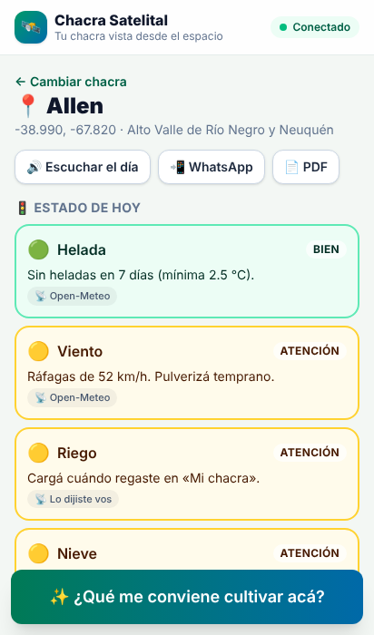
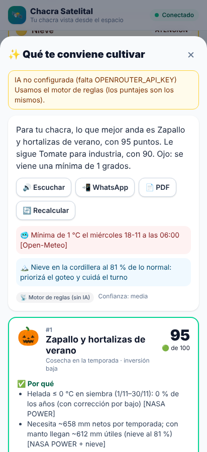

# 🛰️🍐 supernova-eta26 — NASA Space Apps Challenge 2026

Desafío **Adapting Farms with NASA Data** · Región: **Alto Valle de Río Negro y Neuquén**
Nombre provisorio del sitio: **Chacra Satelital** (se cambia en `config/app.ts`).

Web app para chacreros: se marca la chacra en el mapa y se obtiene un tablero con 3 pilares:

1. 🛰️ **Datos de NASA**: POWER (20 años de clima diario), MODIS NDVI y capas GIBS (color real, NDVI, nieve).
2. 👨‍🌾 **El chacrero**: cuenta su chacra escribiendo o por voz, y la IA (OpenRouter) lo ordena en datos.
3. 🌦️ **Pronóstico** de Open-Meteo: 16 días, alertas de helada y viento, evapotranspiración.

El botón ✨ **«¿Qué me conviene cultivar acá?»** combina dos partes: un **motor de reglas** que calcula los puntajes y el semáforo, y la **IA**, que los explica citando fuentes y se puede escuchar en voz alta.

| | |
|---|---|
|  |  |

> Las capturas se hicieron en modo prueba con datos simulados (`MOCK_DATA=1`), porque el entorno de desarrollo no tenía acceso a las APIs. En Vercel se usan los datos reales.

## ✅ Qué incluye esta primera versión (v0.1)

| Funcionalidad | Dónde |
|---|---|
| Mapa del Alto Valle con 11 zonas de referencia y capas de NASA GIBS | `components/MapaLeaflet.tsx`, `config/regions/alto-valle.ts` |
| Indicadores NASA POWER: última helada, período libre de heladas, horas de frío, grados-día, lluvia, ET0, tendencia | `lib/nasa.ts`, `lib/agro.ts` |
| 🧊 Calendario de heladas (20 años × septiembre a noviembre) con floración y corrección por bajo heladizo | `components/CalendarioHeladas.tsx` |
| NDVI MODIS (ORNL DAAC) de los últimos 2 años | `lib/nasa.ts`, `components/Graficos.tsx` |
| Pronóstico de 16 días con alertas y «qué hacer esta semana» | `lib/openmeteo.ts`, `components/tabs/TabClima.tsx` |
| 👨‍🌾 Texto o voz → JSON con IA (y reglas si no hay IA o conexión) | `app/api/farmer`, `lib/extraccionLocal.ts` |
| 🚦 Semáforo: helada, viento, riego, nieve y cultivos | `lib/semaforo.ts`, `components/ui.tsx` |
| ✨ Recomendación: puntaje determinista con 13 cultivos + explicación con IA | `lib/scoring.ts`, `app/api/advisor`, `components/Asesor.tsx` |
| 💧 Calculadora de riego (ET0 × Kc, manto vs. goteo, turno) | `lib/riego.ts`, `components/tabs/TabRiego.tsx` |
| 🏔️ Termómetro de nieve (cuencas del Neuquén y del Limay) | `lib/openmeteo.ts` → `nieveCuencas`, `components/TermometroNieve.tsx` |
| 🎙️ Dictado (es-AR) y 🔊 lectura en voz alta | `hooks/useDictado.ts`, `hooks/useLeer.ts` |
| 📲 WhatsApp y 📄 PDF (informe imprimible A4) | `lib/compartir.ts`, `components/Informe.tsx` |
| 📴 Modo offline (PWA instalable + IndexedDB) | `public/sw.js`, `app/manifest.ts`, `lib/storage.ts`, `hooks/useRecurso.ts` |
| 🌍 Escalable: todo lo propio del Alto Valle está en `config/` | `config/regions/`, `config/cultivos/` |

## 🚀 Correr en local

```bash
npm install
```
```bash
cp .env.example .env.local   # cargar OPENROUTER_API_KEY (opcional)
```
```bash
npm run dev
```
Abrir http://localhost:3000.

**Sin internet** (por ejemplo, en un aula con red bloqueada), con datos simulados que la app marca en pantalla:
```bash
MOCK_DATA=1 npm run dev
```

## ☁️ Deploy en Vercel

1. Importar el repo en Vercel (framework: Next.js, sin cambios en la configuración).
2. Cargar `OPENROUTER_API_KEY` en **Settings → Environment Variables**. `OPENROUTER_MODEL` es opcional.
3. **No** cargar `MOCK_DATA` en producción.

## 🗂️ Estructura

```
app/            páginas (/, /chacra), API (nasa, ndvi, weather, nieve, farmer, advisor), manifest
components/     mapa, tablero, pestañas, semáforo, calendario de heladas, asesor IA, informe PDF
config/         app.ts (nombre) · regions/alto-valle.ts · cultivos/alto-valle.ts
hooks/          voz (dictado y lectura), conexión, datos con respaldo offline
lib/            agro (indicadores), scoring, riego, semáforo, NASA, Open-Meteo, OpenRouter, contexto IA
public/         sw.js (offline), íconos
docs/PLAN.md    plan de trabajo completo
```

## 📡 Fuentes de datos

- **NASA POWER** (`power.larc.nasa.gov`): `T2M_MIN`, `T2M_MAX`, `PRECTOTCORR`, `WS2M` y `GWETROOT` diarios de los últimos 20 años, comunidad AG.
- **NASA MODIS MOD13Q1** vía ORNL DAAC (`modis.ornl.gov`): NDVI de 250 m cada 16 días.
- **NASA GIBS** (`gibs.earthdata.nasa.gov`): capas del mapa (color real, NDVI de 8 días y nieve NDSI).
- **Open-Meteo**: pronóstico, altitud (SRTM) y reanálisis ERA5 (nevadas de la cordillera, plan B del termómetro de nieve).
- **OpenRouter**: modelo de lenguaje que extrae los datos del chacrero y explica la recomendación.

## ⚠️ Pendientes para la próxima iteración

- Termómetro de nieve con **MODIS Snow Cover (NASA)** vía AppEEARS (hoy usa ERA5 como plan B; la capa visual ya es de NASA).
- Validar las coordenadas de las zonas sobre el satélite y los parámetros de los cultivos con **INTA EEA Alto Valle**.
- Probar con datos reales en Vercel (NASA POWER y ORNL pueden tardar 10 a 30 s la primera vez; después quedan cacheados).
- Dibujar el polígono de la chacra, chat de seguimiento con la IA y elegir el nombre definitivo.

Plan completo: [`docs/PLAN.md`](docs/PLAN.md)
