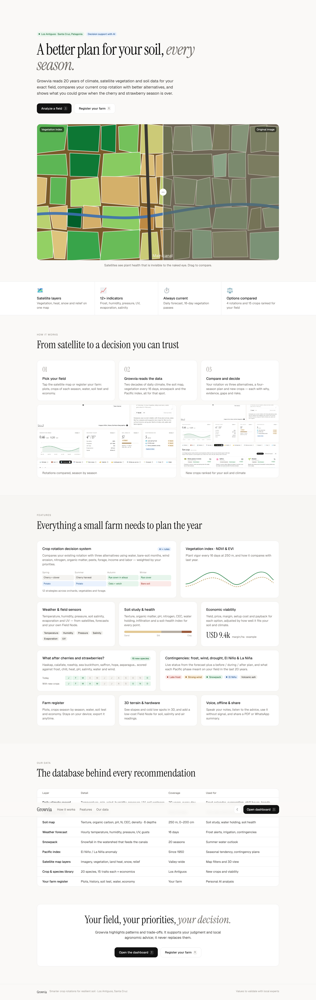
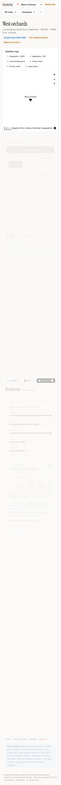

# 🌱 Growvia — NASA Space Apps Challenge 2026 (supernova-eta26)

Desafío **Adapting Farms with NASA Data** · Zona piloto: **Los Antiguos, Santa Cruz (Patagonia)**

Growvia es una herramienta de apoyo a la decisión (en inglés) para productores. Compara la **rotación de cultivos actual con tres alternativas** y arma un **plan para las cuatro estaciones**. También propone **cultivos nuevos** para cuando termina la temporada de cerezas y frutillas, y evalúa su **viabilidad económica** y las **contingencias** (heladas, viento, sequía, El Niño / La Niña). Para todo esto usa observaciones de la Tierra, el suelo, el registro del productor y sus prioridades.

| Introducción | Panel (escritorio) | Celular |
|---|---|---|
|  |  |  |

> Las capturas son del modo de prueba (`MOCK_DATA=1`, "Sample data"). El mapa satelital aparece vacío porque el entorno de desarrollo no tenía internet.

## Páginas
| Ruta | Qué es |
|---|---|
| `/` | **Introducción**: qué es Growvia, comparador "índice de vegetación vs imagen original", cómo funciona (con capturas reales), funciones en bento y **la base de datos** que usa |
| `/app` | **Panel** en grilla bento: mapa satelital con filtros y 3D, IA de decisión, mosaicos de vegetación (NDVI/EVI), clima de hoy, salud del suelo y contingencias, y 11 secciones |
| `/register` | **Registro del productor**: chacra, lotes, qué hubo en cada estación, agua, análisis de suelo, economía y objetivos. Se guarda en el dispositivo y se puede exportar o importar en JSON |

### Secciones del panel (atajos `1`–`0`)
Climate · Soil · Rotations · **Year plan** (primavera, verano, otoño, invierno) · **New crops** · **Viability** · **Contingencies** · What you can do (geotermia, hidroponía, goteo) · Forecast · Frost · Water

Atajos: `A` analizar con IA · `D` vista 3D · `H` hardware · `R` registro · `S` guardar registro.

### Lo nuevo en v0.3
- **Diseño:** paleta monocroma cálida y grilla bento asimétrica. Tarjetas con borde de 1 px `#EAEAEA` y 24 px de padding, CTA `#111111`, badges en azul y verde pastel. Títulos en Instrument Serif y texto en Geist Sans. Animaciones al hacer scroll, atajos `<kbd>`, sin sombras y modo oscuro opcional.
- **Variables nuevas:** índice **EVI** junto a NDVI, **humedad relativa, presión atmosférica, UV**, evaporación y **salinidad** del suelo. La salinidad se estima con aridez, pH, drenaje y riego, o se toma de un análisis o sensor si está cargado.
- **Suelo:** retención de agua y conductividad con las ecuaciones de **Saxton & Rawls**, más un **índice de salud del suelo** (0–100).
- **Cultivos nuevos:** `config/species.ts` reúne 20 especies (cereza y frutilla actuales más haskap, calafate, rosa mosqueta, espino amarillo, azafrán, lavanda, lúpulo, ruibarbo, espárrago, saúco, avellano, quinoa, verduras en túnel, manzana, arándano, nogal). Cada una se evalúa contra la helada en floración, el frío invernal, el calor, las horas de frío, el pH, la salinidad, el agua y el viento.
- **Viabilidad:** rendimiento, precio, margen, inversión y años de recupero, ajustados por la aptitud del lote. Incluye un contexto regional.
- **Contingencias:** heladas tardías, viento, sequía o poca nieve, calor/UV, granizo y ceniza volcánica, con un plan de antes, durante y después. Suma **El Niño / La Niña** (índice ONI en vivo) y qué significó cada fase en ese campo en los últimos 20 años.
- **IA:** también usa el registro, las especies, la salud del suelo y la fase del Pacífico. Devuelve un plan por estación y hasta 3 cultivos nuevos.
- **Hardware:** el Field Node suma sensores de salinidad (EC), aire (temperatura, humedad, presión) y UV.

En la interfaz no aparecen las marcas de las fuentes de datos, para que se vea como un producto real. Las fuentes están en [`docs/estudio-suelo-los-antiguos.md`](docs/estudio-suelo-los-antiguos.md): NASA POWER (temperatura, lluvia, viento, humedad, presión, UV, humedad del suelo), MODIS MOD13Q1 (NDVI/EVI) y capas GIBS, más SoilGrids, Open-Meteo y el índice ONI de NOAA. **Hay que nombrarlas en el pitch y en la página del proyecto para los jueces.**

## 🚀 Correr en local
```bash
npm install
```
```bash
npm run dev
```
Abrir http://localhost:3000 (introducción) o http://localhost:3000/app (panel). Para activar la IA, copiar `.env.example` a `.env.local` y cargar `OPENROUTER_API_KEY`.

Sin internet, con datos de muestra:
```bash
MOCK_DATA=1 npm run dev
```

## 🧪 Estudio de suelo avanzado (un comando)
```bash
npm run soil-study
```
Por cada punto extrae el **perfil completo de suelo** (6 profundidades, 0–200 cm, con rango de incertidumbre). Con eso calcula textura, agua útil y conductividad (Saxton & Rawls), salinidad estimada y salud del suelo. Suma el clima de 20 años, NDVI/EVI, el ranking de las 20 especies con su economía y las rotaciones. Genera `report.md`, `data.json`, `points.csv`, `profile.csv` y `species.csv` en `docs/soil-study/`.

Opciones:
```bash
npm run soil-study -- --lat -46.55 --lon -71.62 --name "Mi chacra"
```
```bash
npm run soil-study -- --grid 3 --system vegetables --irrigation drip
```
```bash
npm run soil-study -- --offline
```
`--offline` usa los valores de referencia y un clima simulado: sirve solo para probar.

## ☁️ Deploy en Vercel
1. Importar el repo en Vercel (Next.js, sin cambios en la configuración).
2. Cargar `OPENROUTER_API_KEY` en Settings → Environment Variables.
3. No cargar `MOCK_DATA` en producción.

## 🗂️ Dónde está cada cosa
```
config/site.ts         Los Antiguos: campos de referencia, cuenca, riego, suelo de referencia
config/crops.ts        cultivos de las rotaciones (Kc mensual, N, cobertura…)
config/species.ts      20 especies: actuales y nuevas, rasgos agronómicos y economía
config/rotations.ts    estrategias de rotación por sistema
lib/rotation.ts        motor de comparación de rotaciones
lib/seasons.ts         grilla por estación y plan anual
lib/suitability.ts     aptitud + viabilidad de especies, cobertura de cosecha por mes
lib/soil.ts            SoilGrids, Saxton & Rawls, salinidad, salud del suelo
lib/enso.ts            El Niño / La Niña (ONI) e impactos por fase en el campo
lib/contingency.ts     contingencias con estado en vivo y planes
lib/register.ts        registro del productor → perfil para el motor y la IA
app/page.tsx           introducción · app/app: panel · app/register: registro
app/api/*              climate, vegetation, forecast, snow, soil, enso, farm (IA), advisor (IA)
components/            Growvia (panel bento), PlanSections, Sections, RegisterForm, landing/*, ui
scripts/soil-study.ts  comando de estudio de suelo avanzado
```

## Pendientes
- Correr `npm run soil-study` con internet y actualizar `docs/estudio-suelo-los-antiguos.md` con los datos reales.
- Validar con INTA y cooperativas los valores de especies, precios y costos, y ubicar los campos sobre chacras reales.
- Sumar SMAP, ECOSTRESS, GPM y GRACE-FO vía AppEEARS (requiere cuenta de Earthdata).
