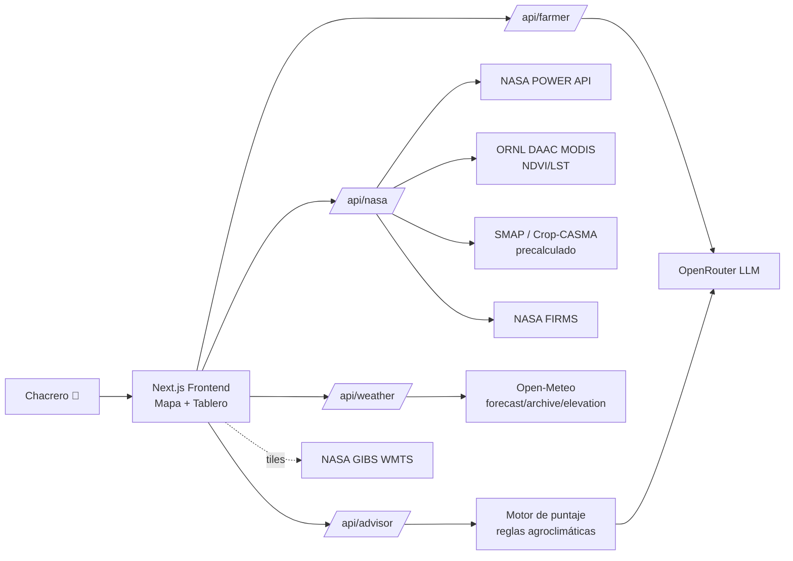

# 🛰️🌱 Plan del Proyecto — "Adapting Farms with NASA Data" (NASA Space Apps 2026)

> **Nombre tentativo:** **ChacrAI** — *"La chacra vista desde el espacio"*
> **Equipo:** supernova-eta26
> **Objetivo en una línea:** una web app donde el chacrero marca su terreno en un mapa y recibe, en un solo tablero, **datos satelitales de NASA**, **el pronóstico de Open-Meteo** y **su propia información de campo procesada por IA**. Un **botón de IA** le dice qué conviene cultivar ahí, por qué y con qué riesgos.

> ⚠️ **Verificar antes de arrancar:** al armar este plan no se pudo leer la página oficial del desafío ([enlace](https://www.spaceappschallenge.org/2026/challenges/adapting-farms-with-nasa-data/?tab=details)). Tampoco se pudo leer la de Watana ni Farmi: la red bloqueó esos dominios. **Tarea #1 del equipo:** abrir la pestaña *Resources* del desafío y comparar la lista de datasets de NASA con la sección 5.1. Agregar los que falten y priorizar los que el desafío nombra explícitamente, porque los jueces lo valoran.

---

## Índice
1. [Entender el desafío](#1-entender-el-desafío)
2. [Qué aprender de los referentes (Watana, Farmi)](#2-qué-aprender-de-los-referentes)
3. [Producto: usuario, problema y propuesta de valor](#3-producto)
4. [Arquitectura técnica](#4-arquitectura-técnica)
5. [Los 3 pilares de datos](#5-los-3-pilares-de-datos)
6. [El botón de IA "¿Qué cultivo acá?"](#6-el-botón-de-ia)
7. [Terrenos de referencia en la Patagonia](#7-terrenos-de-referencia-en-la-patagonia)
8. [Catálogo de cultivos y reglas agroclimáticas](#8-catálogo-de-cultivos)
9. [Cronograma de la competencia (48 h) y roles](#9-cronograma-y-roles)
10. [Estructura del repositorio](#10-estructura-del-repositorio)
11. [Entregables de Space Apps](#11-entregables-de-space-apps)
12. [Ideas extra (diferenciales)](#12-ideas-extra)
13. [Riesgos y mitigaciones](#13-riesgos-y-mitigaciones)
14. [Checklist final](#14-checklist-final)

---

## 1. Entender el desafío

**Tema:** ayudar a los productores a **adaptar sus prácticas agrícolas** (qué, cuándo y cómo sembrar, regar y proteger) usando **datos de observación de la Tierra de NASA**, frente a la variabilidad y el cambio climático.

Lo que los jueces suelen evaluar en Space Apps (las 5 categorías clásicas):

| Criterio | Cómo lo cubrimos |
|---|---|
| **Impacto** | Usuario real y concreto: el chacrero patagónico (Alto Valle, VIRCh, Comarca Andina) con problemas medibles como heladas tardías, viento, agua de riego y sequía. |
| **Creatividad** | Unimos 3 fuentes (NASA + Open-Meteo + el saber del chacrero, procesado por IA) y damos una recomendación explicable. |
| **Validez técnica** | Puntaje agroclimático determinista (reglas) **+** LLM que explica. No dejamos que la IA "invente". |
| **Relevancia** | Uso explícito y visible de datos de NASA (POWER, MODIS, SMAP, GIBS, FIRMS…), con la fuente citada en cada tarjeta. |
| **Presentación** | Demo en vivo en Vercel, video corto y la historia de un chacrero de General Roca. |

**Pregunta guía del proyecto:**
> *"Tengo esta parcela en la Patagonia, con estas condiciones. ¿Qué me conviene cultivar, cuándo y qué riesgos tengo?"*

---

## 2. Qué aprender de los referentes

> Completar y corregir después de leer las páginas. Lo que sigue es lo esperable en proyectos de este tipo.

### Watana Project (ganador 2025)
- [ ] Leer la pestaña *Project* y anotar: **datasets de NASA**, **stack** (frameworks, mapas, IA), **cómo presentaron** (video, slides) y **qué los hizo ganar**.
- [ ] Copiar el *enfoque*, no el producto. Si usaron, por ejemplo, NASA POWER + NDVI + un chatbot, nosotros sumamos lo que les faltó: **pronóstico de corto plazo (Open-Meteo)**, **datos del productor** y **foco regional (Patagonia)**.
- [ ] Anotar qué herramientas reutilizar (librerías, APIs, notebooks).

### Farmi Space (herramienta comercial similar)
- [ ] Revisar sus features (monitoreo de NDVI, alertas, mapas de lotes, etc.).
- **Cómo diferenciarnos:**
  1. **Gratis y abierto**, solo con datos públicos de NASA.
  2. **Asesor de cultivo**: no solo monitorea, también **recomienda qué plantar**.
  3. **Hiperlocal patagónico**: heladas tardías, viento, riego por canal y ceniza volcánica.
  4. **Conversacional**: el chacrero escribe (o dicta) en su idioma y la IA lo convierte en datos.

---

## 3. Producto

### 3.1 Usuario (persona)
**Don Raúl, 58 años, chacrero de Allen (Río Negro).** Tiene 12 ha con riego por canal y perales viejos. El precio de la pera cae y está pensando en reconvertir parte de la chacra (¿nogal? ¿cereza? ¿vid? ¿hortalizas?). Usa WhatsApp y el celular, no usa software agrícola.

**Persona secundaria:** un técnico de INTA o de una cooperativa que asesora a varios productores.

### 3.2 Problemas que resolvemos
1. **Heladas tardías** en primavera, que arruinan la floración (el riesgo número uno de la fruticultura del Alto Valle).
2. **Agua:** turnos de riego, deshielo variable y sequía en la meseta.
3. **Viento** patagónico (cortinas de álamos, daño a frutos).
4. **Decisión de reconversión:** qué cultivo se adapta a *mi* lote.
5. La información está **dispersa y en inglés técnico** (NASA, meteorología).

### 3.3 Flujo de la app (MVP)
```
[1] Landing → "Elegí tu chacra"
[2] Mapa: buscar localidad / tocar el mapa / dibujar polígono
       └─ atajos: "Zonas de referencia" (Alto Valle, VIRCh, El Bolsón…)
[3] Tablero de la parcela, en 3 pestañas:
       🛰️ NASA      │ 👨‍🌾 Mi chacra (IA) │ 🌦️ Clima (Open-Meteo)
[4] Botón flotante:  ✨ "¿Qué me conviene cultivar acá?"
[5] Resultado: Top 3-5 cultivos con puntaje, ventanas de siembra/plantación,
    riesgos, prácticas recomendadas y fuentes citadas
[6] Exportar PDF / compartir por WhatsApp
```

### 3.4 Alcance
| MVP (sí o sí) | Nice to have | Fuera de alcance |
|---|---|---|
| Mapa + selección de punto | Polígono con área en ha | Login de usuarios con base de datos |
| NASA POWER (clima histórico 20+ años) | Serie de NDVI MODIS | Modelos de ML propios entrenados |
| Open-Meteo, pronóstico de 7-16 días | Pronóstico estacional | App móvil nativa |
| Formulario y chat del chacrero → JSON por IA | Entrada por voz | Integración con sensores IoT |
| Botón IA con Top cultivos | Alertas de helada | |
| Deploy en Vercel | Capas GIBS en el mapa, PDF | |

---

## 4. Arquitectura técnica

### 4.1 Stack
| Capa | Tecnología | Por qué |
|---|---|---|
| Frontend + backend | **Next.js 14+ (App Router) + TypeScript** | Un solo repo y deploy directo en Vercel. Las API routes esconden las claves. |
| Estilos | **Tailwind CSS + shadcn/ui** | Rápido y prolijo. |
| Mapa | **Leaflet (react-leaflet)** o **MapLibre GL** | Gratis, sin token, compatible con tiles WMTS de NASA GIBS. |
| Gráficos | **Recharts** o **Chart.js** | Series de temperatura, NDVI y lluvia. |
| IA | **OpenRouter API** (`https://openrouter.ai/api/v1/chat/completions`) | Formato compatible con OpenAI. Permite cambiar de modelo y tener uno de respaldo. |
| Validación | **Zod** | Valida el JSON que devuelve la IA. |
| Cache | `fetch` con `revalidate` de Next / Vercel KV (opcional) | No golpear las APIs de NASA en cada visita. |
| Hosting | **Vercel** | Deploy automático en cada push a `main` y preview por rama. |
| Código | **GitHub + VS Code** (+ Live Share para pair programming) | |

### 4.2 Diagrama


### 4.3 Variables de entorno (Vercel → Settings → Environment Variables)
```
OPENROUTER_API_KEY=...        # NUNCA en el frontend ni en el repo
OPENROUTER_MODEL=...          # modelo principal (elegir uno rápido y barato)
OPENROUTER_FALLBACK_MODEL=... # respaldo si falla o hay rate limit
NASA_FIRMS_MAP_KEY=...        # gratis en firms.modaps.eosdis.nasa.gov/api
EARTHDATA_TOKEN=...           # opcional (AppEEARS), solo para scripts offline
```
Agregar `.env.local` al `.gitignore` y subir un `.env.example` sin valores.

### 4.4 Contrato de datos (la parcela)
```ts
type Parcela = {
  id: string;
  nombre: string;
  lat: number; lon: number;
  poligono?: GeoJSON.Polygon;
  areaHa?: number;
  zonaRef?: string;           // "alto-valle-general-roca"
  nasa?: NasaResumen;         // pilar 1
  chacrero?: DatosChacrero;   // pilar 2
  clima?: ClimaResumen;       // pilar 3
};
```

---

## 5. Los 3 pilares de datos

Cada pestaña del tablero corresponde a un pilar y **cada dato muestra su fuente** (logo de NASA o de Open-Meteo, o "lo dijiste vos").

### 5.1 🛰️ Pilar 1 — Datos de NASA (el clima de largo plazo y el estado del suelo y la vegetación)

| Dataset | Qué nos da | Acceso | Prioridad |
|---|---|---|---|
| **NASA POWER** (comunidad `AG`) | Clima diario 1981→hoy: T2M, T2M_MAX, T2M_MIN, PRECTOTCORR, ALLSKY_SFC_SW_DWN (radiación), RH2M, WS2M (viento), **GWETTOP/GWETROOT** (humedad del suelo), FROST_DAYS | REST sin clave | ⭐ MVP |
| **NASA POWER Climatology** | Promedios mensuales de 30 años, ideales para la "aptitud" | REST sin clave | ⭐ MVP |
| **MODIS NDVI/EVI** (MOD13Q1, 250 m, 16 días) | Vigor de la vegetación y estacionalidad del lote | ORNL DAAC MODIS Web Service (sin clave) o AppEEARS | ⭐ MVP+ |
| **MODIS LST** (MOD11A2) | Temperatura de superficie (noches frías → heladas) | ORNL DAAC / AppEEARS | Nice |
| **SMAP** (SPL3SMP_E / SPL4SMGP) | Humedad de suelo superficial y de raíz | Crop-CASMA (USDA/NASA), AppEEARS o Earthdata | Nice (precalcular) |
| **NASA GIBS / Worldview** | **Capas visuales en el mapa**: True Color, NDVI 8 días, nieve MODIS | WMTS sin clave | ⭐ MVP (visual) |
| **MODIS Snow Cover** (MOD10A1) | Nieve en la cordillera → agua de riego en primavera y verano | GIBS (visual) / AppEEARS | Nice (idea fuerte para Patagonia) |
| **GPM IMERG** | Lluvia satelital de alta resolución | GES DISC / GIBS | Nice |
| **ECOSTRESS / OpenET** | Evapotranspiración → necesidad de riego | AppEEARS | Nice |
| **SRTM / NASADEM** | Altitud y pendiente (las heladas se acumulan en los bajos) | Open-Meteo Elevation u OpenTopography | ⭐ MVP (altitud) |
| **FIRMS** (MODIS/VIIRS) | Focos de incendio recientes (Comarca Andina) | REST con MAP_KEY gratis | Nice |
| **HLS** (Landsat + Sentinel-2, 30 m) | NDVI de alta resolución a nivel lote | AppEEARS / LP DAAC | Stretch |

**Endpoints concretos:**
```text
# NASA POWER — diario
https://power.larc.nasa.gov/api/temporal/daily/point
  ?parameters=T2M,T2M_MAX,T2M_MIN,PRECTOTCORR,ALLSKY_SFC_SW_DWN,RH2M,WS2M,GWETTOP,GWETROOT
  &community=AG&latitude=-39.03&longitude=-67.58
  &start=20050101&end=20251231&format=JSON

# NASA POWER — climatología (promedios mensuales)
https://power.larc.nasa.gov/api/temporal/climatology/point
  ?parameters=T2M,T2M_MIN,T2M_MAX,PRECTOTCORR,WS2M,FROST_DAYS
  &community=AG&latitude=-39.03&longitude=-67.58&format=JSON

# MODIS NDVI — ORNL DAAC (sin auth)
https://modis.ornl.gov/rst/api/v1/MOD13Q1/subset
  ?latitude=-39.03&longitude=-67.58&band=250m_16_days_NDVI
  &startDate=A2024001&endDate=A2025001&kmAboveBelow=0&kmLeftRight=0

# GIBS — tiles para Leaflet
https://gibs.earthdata.nasa.gov/wmts/epsg3857/best/MODIS_Terra_NDVI_8Day/default/{fecha}/GoogleMapsCompatible_Level9/{z}/{y}/{x}.png
https://gibs.earthdata.nasa.gov/wmts/epsg3857/best/MODIS_Terra_CorrectedReflectance_TrueColor/default/{fecha}/GoogleMapsCompatible_Level9/{z}/{y}/{x}.jpg
```

**Indicadores que calculamos (backend `lib/agro.ts`):**
- **Fecha media de la última helada** (Tmin < 0 °C) y **probabilidad de helada en septiembre, octubre y noviembre**, a partir de 20 años de POWER.
- **Período libre de heladas** (días).
- **Grados-día (GDD)** con base 10 °C (vid, maíz) y base 4,5 °C (frutales).
- **Horas de frío** (aproximadas con Tmin/Tmax de mayo a agosto) → clave para pera, manzana y cereza.
- **Lluvia anual** y **déficit hídrico** (ET0 − lluvia).
- **Viento medio** de septiembre a diciembre (estrés en floración).
- **Tendencia**: comparar las décadas 2005-2014 y 2015-2025 → *"tu zona se calentó X °C y llueve Y % menos"* (la narrativa de adaptación al clima).
- **NDVI**: curva anual y comparación con el promedio (¿el lote está más verde o más seco de lo normal?).

> 💡 **Plan B para la demo:** precalcular y guardar JSON de las **zonas de referencia** en `data/zonas/*.json` con un script (`scripts/fetch-nasa.ts`). Si una API de NASA se cae en la presentación, la demo sigue andando.

### 5.2 👨‍🌾 Pilar 2 — Información del chacrero (procesada con IA)

Lo que el satélite **no ve**, lo cuenta el productor. Dos modos:

**a) Formulario rápido (estructurado)**
- Superficie (ha) y uso actual (frutales, pastura, hortalizas, baldío).
- **Agua:** ¿derecho de riego por canal? ¿turno cada cuántos días? ¿pozo? ¿goteo, aspersión o surco?
- **Suelo:** textura (arenoso, franco, arcilloso), ¿salinidad o "salitre"?, ¿napa freática alta?, ¿piedras?
- ¿Tiene cortinas rompevientos (álamos)? ¿Malla antigranizo? ¿Defensa contra heladas (aspersión, quemadores, ventiladores)?
- Mano de obra disponible, presupuesto (bajo, medio o alto) y horizonte (anual o perenne de 5 años o más).
- Objetivo: autoconsumo, mercado local, exportación o agroturismo.
- Historial: heladas que lo afectaron, plagas (carpocapsa), cultivos que fallaron.

**b) Chat libre o voz → la IA lo convierte en JSON**
> *"Tengo 8 hectáreas en Allen, perales de 40 años, riego por manto cada 10 días, el fondo se me hela siempre y el suelo de abajo es medio salitroso. Quiero algo que me dé plata en 3 o 4 años."*

La IA (OpenRouter) devuelve un JSON validado con Zod:
```json
{
  "superficieHa": 8,
  "usoActual": "frutales_pepita",
  "riego": { "tipo": "manto", "frecuenciaDias": 10, "fuente": "canal" },
  "suelo": { "salinidad": "media", "textura": null },
  "microclima": { "bajoHeladizo": true },
  "objetivo": { "plazoAnios": 4, "meta": "rentabilidad" },
  "faltaPreguntar": ["textura del suelo", "presupuesto", "cortinas rompevientos"]
}
```
- La IA **pregunta lo que falta** (`faltaPreguntar`) como un asistente conversacional.
- El chacrero **ve y corrige** los datos extraídos antes de usarlos (transparencia).
- Se guarda en `localStorage` (no hace falta login en el MVP).

### 5.3 🌦️ Pilar 3 — Meteorología de corto plazo (Open-Meteo, sin clave)

| API | Uso |
|---|---|
| `https://api.open-meteo.com/v1/forecast` | Pronóstico de 7 a 16 días: `temperature_2m_min/max`, `precipitation_sum`, `wind_speed_10m_max`, `wind_gusts_10m_max`, `et0_fao_evapotranspiration`, `soil_temperature_0cm`, `soil_moisture_0_to_1cm`, `relative_humidity_2m`, `dew_point_2m` |
| `https://archive-api.open-meteo.com/v1/archive` | Historial reanalizado (ERA5) para validar contra NASA POWER |
| `https://api.open-meteo.com/v1/elevation` | Altitud del punto |
| Seasonal Forecast API | Tendencia de los próximos meses (nice to have) |

Ejemplo:
```text
https://api.open-meteo.com/v1/forecast?latitude=-39.03&longitude=-67.58
 &daily=temperature_2m_max,temperature_2m_min,precipitation_sum,wind_gusts_10m_max,et0_fao_evapotranspiration
 &hourly=temperature_2m,soil_temperature_0cm,soil_moisture_0_to_1cm
 &timezone=America/Argentina/Buenos_Aires&forecast_days=16
```

**Alertas accionables (las tarjetas del tablero):**
- 🥶 **Helada:** Tmin ≤ 0 °C en los próximos 7 días → *"Activá la defensa antiheladas el jueves de madrugada"*.
- 💨 **Viento:** ráfagas > 60 km/h → *"No pulverices"*.
- 💧 **Riego:** balance ET0 − lluvia acumulado → *"Tu cultivo perdió ~25 mm esta semana"*.
- 🌱 **Siembra:** temperatura del suelo > 10 °C sostenida → *"Ventana para sembrar maíz o zapallo"*.

---

## 6. El botón de IA

### ✨ "¿Qué me conviene cultivar acá?"

**Principio clave: IA híbrida y explicable.** El LLM **no inventa números**: los calcula nuestro motor de reglas y el LLM los **interpreta, prioriza y explica** en lenguaje simple.

```
1. Juntar contexto:  NASA (indicadores) + Chacrero (JSON) + Open-Meteo (próximos 16 días)
2. Motor de puntaje (determinista, lib/scoring.ts):
     para cada cultivo del catálogo → puntaje 0-100 por factor
       - helada (fecha de última helada vs. floración)
       - horas de frío
       - grados-día / largo de temporada
       - agua (necesidad vs. riego disponible)
       - suelo (salinidad, textura)
       - viento
       - restricciones del chacrero (plazo, presupuesto, mano de obra)
3. LLM (OpenRouter) recibe: el top 8 con puntajes y factores + el contexto
     → devuelve JSON: top 3-5, por qué, riesgos, prácticas de adaptación,
       calendario, qué datos faltan, confianza
4. UI: tarjetas con semáforo, gráfico radar por factor y un "Ver por qué"
     (cada afirmación con su fuente: NASA POWER, MODIS u Open-Meteo)
```

**System prompt (borrador):**
```text
Sos un ingeniero agrónomo especialista en la Patagonia norte argentina
(Alto Valle, valles irrigados de Río Negro, Neuquén y Chubut, y la Comarca Andina).
Hablás en español rioplatense simple, para un productor ("chacrero").
Recibís: (a) indicadores calculados de datos de NASA, (b) datos del productor,
(c) pronóstico de Open-Meteo, (d) un ranking preliminar de cultivos con puntajes.
REGLAS:
- No inventes números: usá solo los provistos. Si falta un dato, decilo.
- Justificá cada recomendación citando la fuente: [NASA POWER], [MODIS], [Open-Meteo], [Productor].
- Incluí prácticas de ADAPTACIÓN climática (riego por goteo, defensa antiheladas,
  cortinas rompevientos, malla antigranizo, variedades de floración tardía).
- Respondé SOLO con JSON válido según el esquema.
```

**Esquema de respuesta:**
```json
{
  "recomendaciones": [{
    "cultivo": "Cerezo (variedades tardías)",
    "puntaje": 78,
    "porQue": ["Acumula ~1100 horas de frío [NASA POWER]", "..."],
    "riesgos": ["Heladas en octubre con 30 % de probabilidad [NASA POWER]"],
    "adaptaciones": ["Defensa activa contra heladas", "Riego por goteo"],
    "calendario": "Plantación en julio-agosto; primera cosecha en el año 3-4",
    "inversion": "alta"
  }],
  "alertaCortoPlazo": "Helada pronosticada el 18/11 [Open-Meteo]",
  "datosFaltantes": ["análisis de suelo"],
  "confianza": "media",
  "disclaimer": "Orientativo. Consultá con INTA o un ingeniero agrónomo."
}
```

**Detalles técnicos:**
- Llamada **server-side** en `app/api/advisor/route.ts` (la clave nunca llega al navegador).
- `response_format: { type: "json_object" }` cuando el modelo lo soporte, más validación con Zod y un reintento.
- **Streaming** del texto explicativo para que se sienta rápido.
- **Modelo de respaldo** configurado en OpenRouter para evitar caídas en la demo.
- Respuestas de demo cacheadas para las zonas de referencia (Plan B si no hay internet).
- Un segundo botón: 💬 **"Preguntale a ChacrAI"**, un chat que usa todo el contexto de la parcela (*"¿y si pongo goteo?"*, *"¿cuándo podo?"*).

---

## 7. Terrenos de referencia en la Patagonia

Precargarlos como **"Zonas de referencia"** (botones en el mapa) y usar 3 de ellos en la demo para mostrar que la recomendación **cambia según el lugar**.

| # | Zona | Localidad (lat, lon aprox.) | Perfil productivo | Desafío climático clave | Por qué sirve en la demo |
|---|---|---|---|---|---|
| 1 | **Alto Valle de Río Negro** ⭐ | **General Roca** (-39.03, -67.58) | Peras y manzanas (polo exportador), vid | **Heladas tardías**, granizo, reconversión frutícola | Caso principal: el "chacrero" típico |
| 2 | Alto Valle | **Allen** (-38.98, -67.83) / **Cipolletti** (-38.93, -67.99) | Pera Williams, horticultura periurbana | Heladas, presión urbana sobre chacras | Variante del caso 1 |
| 3 | Alto Valle Este | **Villa Regina** (-39.10, -67.08) | Fruticultura, vid | Heladas y viento | Comparación dentro del valle |
| 4 | Neuquén | **San Patricio del Chañar** (-38.63, -68.30) | **Vinos de alta gama**, frutales nuevos con goteo | Aridez y viento: todo depende del riego | Muestra la reconversión a la vid |
| 5 | Valle Medio | **Choele Choel / Luis Beltrán** (-39.29, -65.66) | Frutales, **nogales**, pasturas, tomate | Más temporada y calor que el Alto Valle | Contraste: aquí ganan cultivos de calor |
| 6 | Valle Inferior (IDEVI) | **Viedma** (-40.80, -63.00) | Hortalizas, cebolla, pasturas, avellano | Viento y salinidad | Escala de valle irrigado planificado |
| 7 | Río Colorado | **Río Colorado** (-38.99, -64.09) | Frutales, cebolla, alfalfa | Transición con la región pampeana | Borde norte |
| 8 | **VIRCh (Chubut)** ⭐ | **Gaiman** (-43.29, -65.49) / **Trelew** (-43.25, -65.31) | Alfalfa, cerezas, hortalizas, frutilla | **Período libre de heladas corto**, viento, salinidad | Contraste frío y ventoso |
| 9 | Valle de Sarmiento | **Sarmiento, Chubut** (-45.59, -69.07) | Cerezas, pasturas, horticultura | Clima frío y árido, viento extremo | Límite sur de la aptitud |
| 10 | **Comarca Andina del Paralelo 42** ⭐ | **El Bolsón** (-41.96, -71.53) / **Lago Puelo** (-42.07, -71.60) | **Fruta fina** (frambuesa, frutilla), **lúpulo**, cerezas | Heladas, **incendios forestales** (FIRMS), más lluvia | Contraste húmedo cordillerano |
| 11 | Valle 16 de Octubre | **Trevelin** (-43.09, -71.46) | Frutas finas, tulipanes, pasturas | Frío y ceniza volcánica | Agroturismo |
| 12 | Los Antiguos | **Los Antiguos, Santa Cruz** (-46.55, -71.63) | **Cerezas de exportación** (microclima del Lago Buenos Aires) | Microclima y ceniza (volcán Hudson) | "Lo que el satélite muestra": un oasis |

**Trío para la demo (recomendado):**
1. 🍐 **General Roca** → heladas tardías: ¿reconvertir perales? (*nogal, cerezo tardío, vid*).
2. 🌬️ **Gaiman (VIRCh)** → temporada corta y viento (*alfalfa, cerezo con cortinas, hortalizas de ciclo corto*).
3. 🌲 **El Bolsón** → húmedo y cordillerano (*frambuesa, lúpulo, frutilla*), con alerta FIRMS de incendios.

> Validar coordenadas exactas sobre el mapa (que caigan en **zona irrigada**, no en la barda o la meseta). Usar la capa True Color de GIBS para mostrar el "verde del valle" contra la meseta árida: **queda muy bien visualmente**.

**Fuentes locales para validar las reglas:** INTA EEA Alto Valle, INTA EEA Chubut (Trelew), INTA EEA Valle Inferior, INTA Bariloche / AER El Bolsón, Secretaría de Fruticultura de Río Negro, Departamento Provincial de Aguas (turnos de riego), datos de heladas de estaciones del INTA y del SMN.

---

## 8. Catálogo de cultivos

Archivo `data/cultivos.json`. Las reglas son **orientativas**: validarlas con bibliografía de INTA y ajustarlas durante el hackathon.

| Cultivo | Tipo | Horas de frío | Sensibilidad a la helada en floración | Temporada mínima libre de heladas | Agua | Tolera salinidad | Años a producir |
|---|---|---|---|---|---|---|---|
| Peral | Perenne | 600–1200 | Alta (sept–oct) | 150 d | Alta | Media | 4–5 |
| Manzano | Perenne | 800–1200 | Alta | 150 d | Alta | Baja | 3–5 |
| Cerezo (tardío) | Perenne | 800–1300 | Muy alta | 140 d | Media | Baja | 3–4 |
| Nogal | Perenne | 400–1500 | Alta (brotación) | 180 d | Alta | Baja | 5–7 |
| Vid (vino) | Perenne | 100–500 | Media | 170 d, GDD > 1400 | Media-baja | Media | 3 |
| Avellano | Perenne | 800–1200 | Media | 150 d | Media | Baja | 4–5 |
| Frambuesa / fruta fina | Perenne | 700–1000 | Media | 110 d | Media | Baja | 1–2 |
| Lúpulo | Perenne | — | Media | 120 d | Media-alta | Baja | 2 |
| Frutilla | Semiperenne | — | Media | 100 d | Media | Baja | 1 |
| Alfalfa | Forraje | — | Baja | 90 d | Media | Alta | 1 |
| Tomate de industria | Anual | — | Muy alta (sin heladas) | 140 d, GDD > 1200 | Alta | Media | 0 (anual) |
| Cebolla | Anual | — | Baja | 150 d | Media | Media | 0 |
| Papa | Anual | — | Media | 100 d | Media | Baja | 0 |
| Zapallo / hortalizas de verano | Anual | — | Muy alta | 110 d | Media | Media | 0 |
| Ajo | Anual | Requiere frío | Baja | — | Baja | Media | 0 |

**Fórmula de puntaje (ejemplo):**
```
puntaje = 100 × Π(factor_i ^ peso_i)
factor_helada = 1 − P(helada en floración del cultivo)
factor_frio   = clamp((horasFrioZona − min) / (opt − min), 0, 1)
factor_agua   = disponibilidad del productor ÷ necesidad (ET0·Kc − lluvia)
factor_suelo  = tabla de salinidad y textura
factor_plazo  = 1 si añosAProducir ≤ plazo del chacrero, si no se penaliza
```

---

## 9. Cronograma y roles

### 9.1 Roles sugeridos (adaptar al tamaño del equipo)
| Rol | Responsabilidades |
|---|---|
| **A — Frontend / UX** | Next.js, mapa Leaflet, tablero, tarjetas, responsive mobile-first |
| **B — Datos NASA** | APIs de POWER, MODIS y GIBS, indicadores agroclimáticos, JSON de zonas |
| **C — IA / backend** | OpenRouter, prompts, Zod, motor de puntaje, chat |
| **D — Agro + pitch** | Catálogo de cultivos, validación con INTA, historia, video, slides y página del proyecto |

### 9.2 Timeline (asumiendo ~48 h; ajustar a los horarios oficiales)

**⏱️ Hora 0–2 — Arranque**
- [ ] Leer el desafío completo y la pestaña de recursos; ajustar este plan.
- [ ] Revisar Watana y Farmi (sección 2).
- [ ] Crear el proyecto: `npx create-next-app@latest chacrai --ts --tailwind --app`.
- [ ] Conectar el repo a **Vercel** → primer deploy de "Hola mundo" (¡desde la hora 1!).
- [ ] Crear la cuenta en **OpenRouter**, cargar la key en Vercel y probar con `curl`.
- [ ] Crear la clave FIRMS y la cuenta de Earthdata (si se usan).
- [ ] Definir el nombre, el logo y la paleta (verde valle + azul NASA).

**⏱️ Hora 2–10 — Fundaciones (en paralelo)**
- A: layout, mapa con un click que marca la parcela, zonas de referencia, 3 pestañas vacías.
- B: `/api/nasa` con POWER (diario + climatología) → indicadores de heladas, GDD y horas de frío.
- C: `/api/weather` (Open-Meteo) y `/api/farmer` (texto → JSON con OpenRouter).
- D: `cultivos.json`, guion de la demo, textos de la UI y persona.

**⏱️ Hora 10–20 — Integración del MVP**
- [ ] El tablero muestra datos reales de los 3 pilares.
- [ ] Motor de puntaje `lib/scoring.ts` + `/api/advisor`.
- [ ] Botón ✨ funcionando de punta a punta en General Roca.
- [ ] Gráficos: temperatura mínima por mes, probabilidad de heladas y lluvia.

**⏱️ Hora 20–26 — Descanso + buffer** 😴 (en serio: dormir mejora la presentación)

**⏱️ Hora 26–36 — Pulido y diferenciales**
- [ ] NDVI MODIS + capas GIBS en el mapa.
- [ ] Alertas de helada y viento (Open-Meteo).
- [ ] Chat "Preguntale a ChacrAI".
- [ ] Mobile responsive, estados de carga y manejo de errores.
- [ ] Precalcular los JSON de las zonas (Plan B offline).

**⏱️ Hora 36–44 — Entregables**
- [ ] Video demo (ver sección 11).
- [ ] Slides y página del proyecto en Space Apps (descripción, datos de NASA usados, uso de IA, enlaces).
- [ ] README final con capturas.

**⏱️ Hora 44–48 — Freeze**
- [ ] **Code freeze** 2 h antes del cierre.
- [ ] Probar la demo en otro dispositivo y con otra red.
- [ ] Enviar todo **al menos 1 h antes** de la hora límite.

### 9.3 Flujo de Git
- `main` = siempre deployable (Vercel production).
- Ramas por feature: `feat/mapa`, `feat/nasa-power`, `feat/ai-advisor`…
- PR chicos y merge rápido; cada PR genera un **preview de Vercel** para probar.
- Commits: `feat:`, `fix:`, `docs:`.

---

## 10. Estructura del repositorio

```
supernova-eta26/
├── README.md
├── docs/
│   ├── PLAN.md                ← este documento
│   ├── pitch.md               ← guion del video y las slides
│   └── datos-nasa.md          ← detalle de los datasets usados (para jueces)
├── app/
│   ├── page.tsx               ← landing + mapa
│   ├── parcela/[id]/page.tsx  ← tablero de 3 pestañas
│   └── api/
│       ├── nasa/route.ts      ← POWER + MODIS + FIRMS
│       ├── weather/route.ts   ← Open-Meteo
│       ├── farmer/route.ts    ← texto → JSON (OpenRouter)
│       ├── advisor/route.ts   ← botón IA
│       └── chat/route.ts      ← chat con contexto
├── components/
│   ├── Map.tsx  ZonaSelector.tsx  NasaTab.tsx  FarmerTab.tsx
│   ├── WeatherTab.tsx  AdvisorButton.tsx  CropCard.tsx  Charts/
├── lib/
│   ├── nasa.ts  openmeteo.ts  openrouter.ts
│   ├── agro.ts                ← heladas, GDD, horas de frío, balance hídrico
│   ├── scoring.ts             ← motor de puntaje
│   └── schemas.ts             ← Zod
├── data/
│   ├── cultivos.json
│   ├── zonas.json             ← las 12 zonas de referencia
│   └── cache/                 ← JSON precalculados (Plan B)
├── scripts/fetch-nasa.ts      ← precarga de datos
├── .env.example
└── public/ (logo, capturas)
```

---

## 11. Entregables de Space Apps

> Confirmar los requisitos exactos en la página oficial (normalmente: título, resumen, enlace a la demo o repo, uso de datos de NASA, uso de IA y un video o slides de pocos minutos).

**Guion del video (~2–3 min, o el formato que pidan):**
1. **Problema (20 s):** *"En octubre de 20XX una helada tardía arruinó buena parte de la cosecha del Alto Valle…"* + foto de una chacra.
2. **Solución (15 s):** ChacrAI y sus 3 pilares.
3. **Demo (90 s):** Don Raúl en General Roca → marca la parcela → pestaña NASA (heladas de 20 años, NDVI) → escribe su situación → pestaña Clima (alerta de helada) → **botón ✨** → Top 3 con fuentes. Cambiar a Gaiman y El Bolsón: **la recomendación cambia**.
4. **Datos de NASA (15 s):** logos y lista (POWER, MODIS, GIBS, SMAP, FIRMS).
5. **Impacto y futuro (20 s):** cooperativas, INTA, WhatsApp bot, otras regiones.

**Declarar el uso de IA** (Space Apps lo pide): qué partes usan LLM (OpenRouter), para qué y cómo evitamos alucinaciones.

---

## 12. Ideas extra

1. 🧊 **"Calendario de heladas"**: un heatmap de 20 años × días (sept–nov) con las heladas de POWER. Es un gráfico que impacta.
2. 🏔️ **Termómetro de nieve → agua de riego**: la cobertura de nieve MODIS en la cuenca del Limay/Neuquén (o del Chubut) da un anticipo de cuánta agua habrá en el verano. Es muy patagónico y original.
3. 📈 **"Tu zona hace 20 años vs. hoy"**: tendencias de temperatura, lluvia y heladas → la narrativa de *adaptación*.
4. 🗺️ **Comparador de lotes**: dos parcelas lado a lado.
5. 🎙️ **Entrada por voz** (Web Speech API) para el chacrero que no quiere escribir.
6. 📲 **Compartir por WhatsApp** el resumen y **exportar PDF** para el técnico o el banco.
7. 🌋 **Alerta de ceniza volcánica / incendios** (FIRMS) para la Comarca y la cordillera.
8. 🧮 **Calculadora de riego**: ET0 (Open-Meteo) × Kc del cultivo → mm y horas de goteo.
9. 🌐 **Modo offline / PWA** para zonas rurales con mala señal.
10. 🤝 **Modo técnico**: un asesor del INTA con varias chacras.
11. 🏷️ **Semáforo simple** (verde, amarillo, rojo) para quien no quiere gráficos.
12. 🌍 **Escalable**: el mismo motor sirve para cualquier lugar del mundo (POWER y Open-Meteo son globales); la Patagonia es el caso piloto.

---

## 13. Riesgos y mitigaciones

| Riesgo | Mitigación |
|---|---|
| Las APIs de NASA son lentas o se caen | Cache + JSON precalculados de las zonas (`data/cache`) |
| AppEEARS o SMAP necesitan autenticación y son asíncronos | Usar ORNL DAAC / GIBS en vivo y precalcular SMAP con un script |
| Rate limit o caída de OpenRouter | Modelo de respaldo + respuestas cacheadas para la demo |
| La IA "alucina" | Motor de reglas determinista + JSON con Zod + fuentes citadas + disclaimer |
| La clave filtrada en GitHub | Solo variables de entorno en Vercel, `.env.local` en `.gitignore` |
| Resolución gruesa de POWER (~0,5°) | Explicarlo, complementar con NDVI de 250 m y con el dato del chacrero (microclima) |
| Scope creep | Cumplir el MVP primero (sección 3.4); los nice to have solo después de la hora 20 |
| Sin internet en la presentación | Video grabado + build con datos cacheados |

---

## 14. Checklist final

- [ ] Deploy en Vercel funcionando (URL pública).
- [ ] Los 3 pilares visibles y con fuentes citadas.
- [ ] El botón IA responde en menos de 10 s en las 3 zonas de demo.
- [ ] Mobile OK.
- [ ] README con descripción, capturas, cómo correrlo y datos de NASA usados.
- [ ] Sin claves en el repo (`git log -p | grep -i key`).
- [ ] Video y slides subidos.
- [ ] Página del proyecto en Space Apps completa (incluida la declaración de uso de IA).
- [ ] Envío realizado antes de la hora límite. 🚀

---
*Este plan es un documento vivo: actualizarlo a medida que avanza la competencia.*
