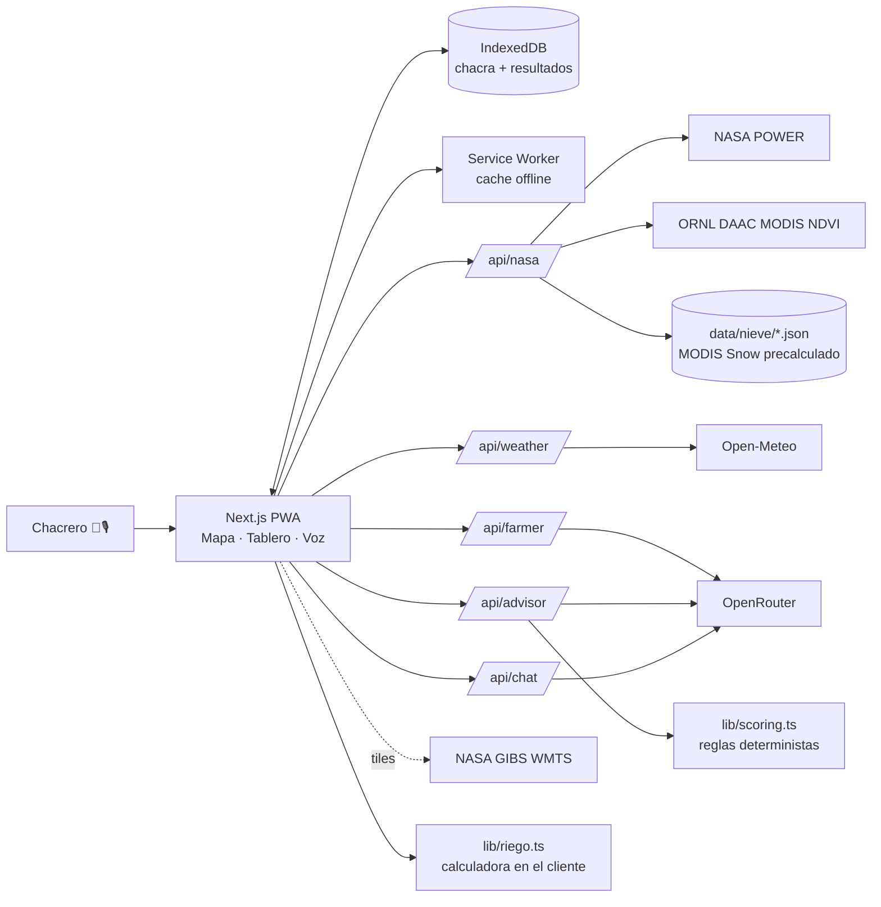

# 🛰️🍐 Plan de trabajo — "Adapting Farms with NASA Data" (NASA Space Apps 2026)

> **Equipo:** supernova-eta26 · **Región elegida:** 🍐 **Alto Valle de Río Negro y Neuquén** (decidido)
> **Nombre del sitio:** **pendiente**. En el código usamos la constante `APP_NAME` (en `config/app.ts`), así cambiarlo es una sola línea. Hay ideas en la [sección 14](#14-nombre-pendiente).
>
> **Objetivo en una línea:** una web app donde el chacrero del Alto Valle marca su chacra en un mapa y recibe, en un solo tablero, **datos satelitales de NASA**, **el pronóstico de Open-Meteo** y **su propia información procesada por IA**. Un **botón de IA** le dice qué conviene cultivar ahí, cuánto regar y qué riesgos tiene. Se puede usar **por voz**, **sin conexión** y **compartir por WhatsApp o PDF**.

> ⚠️ **Tarea 0 (hora 0):** abrir la página oficial del desafío ([enlace](https://www.spaceappschallenge.org/2026/challenges/adapting-farms-with-nasa-data/?tab=details)) y la de Watana ([enlace](https://www.spaceappschallenge.org/2025/find-a-team/watana-project/?tab=project)). Comparar los datasets de NASA de la pestaña *Resources* con la [sección 5.1](#51-️-pilar-1--nasa) y agregar los que el desafío nombre explícitamente. No pudimos leerlas al armar el plan.

---

## 🔄 Cambio de enfoque (v0.2: Growvia)
El equipo redefinió el proyecto. **Este plan queda como historial; la versión vigente está en el [README](../README.md).**
- Nombre: **Growvia** · app en **inglés** · **tema oscuro** · diseño según el prototipo (IA a la izquierda, mapa, filtros a la derecha, estadísticas abajo).
- Zona: **Los Antiguos (Santa Cruz)**, en lugar del Alto Valle.
- Foco del desafío: **comparar estrategias de rotación** (la actual + 3 alternativas) para la salud del suelo y el agua.
- Nuevo: estudio de suelo ([`estudio-suelo-los-antiguos.md`](estudio-suelo-los-antiguos.md)), "What you can do" (geotermia, hidroponía, goteo), **3D View**, **Hardware** (sensores en el campo).
- En la interfaz no aparecen las marcas de las fuentes de datos; se documentan para el pitch.

## Índice
1. [Alcance final (qué entra y qué no)](#1-alcance-final)
2. [El problema en el Alto Valle](#2-el-problema-en-el-alto-valle)
3. [Experiencia de usuario](#3-experiencia-de-usuario)
4. [Arquitectura técnica (escalable)](#4-arquitectura-técnica)
5. [Los 3 pilares de datos](#5-los-3-pilares-de-datos)
6. [Botón IA + semáforo](#6-botón-ia--semáforo)
7. [Funcionalidades extra elegidas (especificación)](#7-funcionalidades-extra)
8. [Zonas de referencia del Alto Valle](#8-zonas-de-referencia-del-alto-valle)
9. [Catálogo de cultivos del Alto Valle](#9-catálogo-de-cultivos)
10. [Backlog de tareas por rol](#10-backlog-de-tareas)
11. [Cronograma de 48 h](#11-cronograma-de-48-h)
12. [Estructura del repo y arranque](#12-estructura-del-repo-y-arranque)
13. [Entregables, riesgos y checklist](#13-entregables-riesgos-y-checklist)
14. [Nombre (pendiente)](#14-nombre-pendiente)

---

## 1. Alcance final

### ✅ Núcleo (MVP obligatorio)
| # | Funcionalidad |
|---|---|
| N1 | Mapa del Alto Valle: elegir una zona de referencia, tocar el mapa o dibujar la chacra |
| N2 | Pestaña 🛰️ **NASA**: clima de 20 años (heladas, frío, calor), NDVI y capas satelitales |
| N3 | Pestaña 👨‍🌾 **Mi chacra**: formulario + texto libre → la IA lo convierte en datos |
| N4 | Pestaña 🌦️ **Clima**: pronóstico de 16 días y alertas (Open-Meteo) |
| N5 | Botón ✨ **"¿Qué me conviene cultivar acá?"**: puntaje por reglas + explicación de la IA con fuentes |
| N6 | Deploy en Vercel |

### ⭐ Extras elegidos (todos entran)
| # | Extra | Detalle |
|---|---|---|
| E1 | 🏔️ **Termómetro de nieve** | Nieve en las cuencas del Neuquén y del Limay → anticipo del agua de riego ([7.1](#71-️-termómetro-de-nieve)) |
| E2 | 🧊 **Calendario de heladas** | Heatmap de 20 años × días de septiembre a noviembre ([7.2](#72--calendario-de-heladas)) |
| E3 | 🎙️🔊 **Voz** | Dictado del chacrero (voz → texto) + la IA lee la respuesta en voz alta ([7.3](#73-️-voz-dictado--lectura-en-voz-alta)) |
| E4 | 📲📄 **Compartir** | Resumen por WhatsApp + informe en PDF ([7.4](#74--compartir-whatsapp--pdf)) |
| E5 | 💧 **Calculadora de riego** | ET0 × Kc − lluvia → mm, m³ y horas, adaptado al turno de riego ([7.5](#75--calculadora-de-riego)) |
| E6 | 🚦 **Semáforo simple** | Verde, amarillo o rojo en cultivos y en el "estado de hoy" ([6.3](#63--semáforo)) |
| E7 | 🌍 **Escalable** | Arquitectura por región: el Alto Valle es la primera configuración ([4.3](#43-escalabilidad-diseño-por-región)) |
| E8 | 📴 **Modo offline** | PWA + datos cacheados; puntaje y semáforo funcionan sin red ([7.6](#76--modo-offline-pwa)) |

### ❌ Fuera de alcance (no hacer en la competencia)
Login y base de datos de usuarios · comparador de lotes · modo técnico multi-chacra · alertas de incendio y ceniza (FIRMS) · otras regiones de la Patagonia (quedan como "próximas regiones" en el pitch) · app nativa · modelos de ML propios.

---

## 2. El problema en el Alto Valle

**Contexto:** el Alto Valle es el principal polo de **peras y manzanas** de Argentina. Son ~100 km de valle irrigado sobre los ríos Neuquén y Negro, entre Cinco Saltos/Centenario y Chichinales, con miles de chacras chicas y medianas regadas por el **Canal Principal** (toma en el dique Ballester) y una red de canales administrada por **consorcios de riego**. El riego mayoritario es **a manto o surco por turnos**.

**Dolores del chacrero (en orden de importancia):**
1. 🥶 **Heladas tardías** (septiembre a noviembre) durante la floración y el cuajado. Es el riesgo número uno: una sola noche puede costar la cosecha. Se defiende con aspersión, calefactores o ventiladores, que cuestan plata y hay que saber **cuándo** prenderlos.
2. 💧 **Agua:** el turno de riego es fijo, pero la demanda del cultivo varía. Un año con poca nieve en la cordillera significa menos caudal en el verano.
3. 📉 **Reconversión:** montes de pera viejos con precio bajo. ¿Replanto pera? ¿Paso a manzana, cerezo, nogal, vid, hortalizas o alfalfa?
4. 🧂 **Suelos:** sectores bajos con napa alta y salinidad.
5. 💨 **Viento** en primavera (cortinas de álamos) y **granizo** (malla).
6. 📱 La información existe pero está dispersa, es técnica y está en inglés.

**Persona:** *Don Raúl, 58 años, chacrero de Allen.* 10 ha, perales Williams de 40 años, riego a manto por turno cada ~10 días, el "fondo" de la chacra se le hiela. Usa WhatsApp y prefiere hablar a escribir.

---

## 3. Experiencia de usuario

```
[1] Landing: "¿Dónde está tu chacra?"  (botón 🎙️ disponible siempre)
[2] Mapa del Alto Valle (vista inicial: bbox del valle)
      ├─ Chips de zonas: Cinco Saltos · Cipolletti · Allen · Roca · Huergo · Regina…
      ├─ Tocar el mapa = punto · Dibujar = polígono (calcula las ha)
      └─ Capas: Satélite NASA (True Color) · NDVI · Nieve
[3] Tablero de la chacra
      🚦 "Estado de hoy" (semáforo: helada · viento · riego)
      Pestañas:  🛰️ NASA  |  👨‍🌾 Mi chacra  |  🌦️ Clima  |  💧 Riego  |  🏔️ Nieve
[4] ✨ "¿Qué me conviene cultivar acá?" → Top 3-5 con semáforo, puntaje, por qué, riesgos y adaptaciones
      ├─ 🔊 Escuchar   ├─ 📲 WhatsApp   ├─ 📄 PDF
[5] 💬 "Preguntale a la IA" (chat con todo el contexto, por texto o voz)
```

**Principios de diseño:**
- **Mobile first.** Se usa en el celular, en la chacra, con sol: alto contraste y botones grandes.
- **Lenguaje de chacrero:** "helada", "turno", "monte", "bajo", "manto". Nada de "GWETROOT" en la UI.
- **Cada dato con su sello de fuente:** `NASA POWER`, `MODIS`, `Open-Meteo` o `Lo dijiste vos`.
- **Semáforo primero, detalle después:** quien quiere más, toca "Ver por qué".

---

## 4. Arquitectura técnica

### 4.1 Stack
| Capa | Tecnología |
|---|---|
| App | **Next.js (App Router) + TypeScript**, deploy en **Vercel** |
| UI | **Tailwind CSS + shadcn/ui** |
| Mapa | **react-leaflet** + Leaflet.draw (polígono) + tiles **NASA GIBS** |
| Gráficos | **Recharts** (series) + heatmap propio en SVG o `<canvas>` (calendario de heladas) |
| IA | **OpenRouter** (`/api/v1/chat/completions`): modelo principal + respaldo, por variables de entorno |
| Validación | **Zod** |
| Voz | **Web Speech API**: `SpeechRecognition` (dictado) + `speechSynthesis` (lectura en voz alta) |
| PDF | Vista `/informe` con CSS de impresión → "Guardar como PDF" (cero dependencias, funciona offline) |
| Offline | **Serwist** (`@serwist/next`, service worker para PWA) + **idb-keyval** (IndexedDB) |
| Código | GitHub + VS Code (Live Share) |

### 4.2 Diagrama


### 4.3 Escalabilidad: diseño por región
Toda la lógica es **global**, porque NASA POWER y Open-Meteo cubren el planeta. Lo que es propio del Alto Valle vive en **un solo archivo de configuración**:

```ts
// config/regions/alto-valle.ts
export const altoValle: RegionConfig = {
  id: "alto-valle",
  nombre: "Alto Valle de Río Negro y Neuquén",
  pais: "AR", idioma: "es-AR", timezone: "America/Argentina/Buenos_Aires",
  bbox: [[-39.20, -68.30], [-38.70, -66.85]],
  centro: [-38.98, -67.70], zoom: 10,
  zonas: [...],                         // sección 8
  cultivos: "data/cultivos/alto-valle.json",
  cuencasNieve: ["neuquen-alta", "limay-alta"],
  riego: { sistemaDefault: "manto", turnoDefaultDias: 10, organismo: "Consorcios de riego / DPA Río Negro" },
  fenologia: { floracionPepita: ["09-15", "10-15"] }, // ventana crítica de heladas
};
```
- **Agregar una región** (VIRCh, Valle Medio, Mendoza, otro país) = un `config/regions/<id>.ts` + un JSON de cultivos. Sin tocar el motor.
- Los textos de la UI van en `config/i18n/es-AR.ts` (preparado para otros idiomas).
- **Para el pitch:** "Empezamos por el Alto Valle; el motor ya funciona en cualquier lugar del mundo."

### 4.4 Variables de entorno (Vercel → Settings → Environment Variables)
```
OPENROUTER_API_KEY=          # solo en el servidor, nunca en el repo
OPENROUTER_MODEL=            # rápido y barato, que soporte JSON
OPENROUTER_FALLBACK_MODEL=   # respaldo
EARTHDATA_TOKEN=             # solo para scripts offline (nieve, SMAP), opcional
```
Subir `.env.example` sin valores. `.env.local` ya está en `.gitignore`.

### 4.5 Modelo de datos
```ts
type Chacra = {
  id: string; nombre: string; regionId: "alto-valle";
  lat: number; lon: number; poligono?: GeoJSON.Polygon; areaHa?: number;
  zonaRef?: string;
  chacrero?: DatosChacrero;       // pilar 2
  ultimaActualizacion: string;    // ISO, para el banner offline
};
type Resultados = {
  nasa?: NasaResumen; clima?: ClimaResumen; nieve?: NieveResumen;
  ranking?: CultivoPuntaje[]; recomendacionIA?: RecomendacionIA;
};
```

---

## 5. Los 3 pilares de datos

### 5.1 🛰️ Pilar 1 — NASA

| Dataset | Uso en la app | Acceso | Prioridad |
|---|---|---|---|
| **NASA POWER** diario (`community=AG`) | Base del **calendario de heladas**, horas de frío, grados-día. Variables: `T2M_MIN, T2M_MAX, T2M, PRECTOTCORR, ALLSKY_SFC_SW_DWN, RH2M, WS2M, GWETTOP, GWETROOT` | REST sin clave | ⭐ MVP |
| **NASA POWER** climatología | Promedios mensuales para la aptitud y la calculadora de riego mensual | REST sin clave | ⭐ MVP |
| **MODIS NDVI** (MOD13Q1, 250 m) | Curva de vigor de la chacra y comparación con el promedio | ORNL DAAC web service (sin clave) | ⭐ MVP |
| **NASA GIBS** | Capas del mapa: True Color, NDVI 8 días, **nieve (MODIS Snow Cover)** | WMTS sin clave | ⭐ MVP |
| **MODIS Snow Cover** (MOD10A1/MOD10A2) | **Termómetro de nieve** (% de cuenca nevada vs. promedio) | AppEEARS (precalculado con script) / GIBS (visual) | ⭐ Extra E1 |
| **SRTM / NASADEM** | Altitud: detecta los "bajos" heladizos (vía Open-Meteo Elevation) | REST | ⭐ MVP |
| **SMAP** (humedad de suelo) | Contexto de humedad de suelo | AppEEARS / Crop-CASMA | Si sobra tiempo |

```text
# POWER diario (Allen)
https://power.larc.nasa.gov/api/temporal/daily/point?parameters=T2M_MIN,T2M_MAX,T2M,PRECTOTCORR,ALLSKY_SFC_SW_DWN,RH2M,WS2M,GWETTOP,GWETROOT&community=AG&latitude=-38.98&longitude=-67.83&start=20050101&end=20251231&format=JSON
# POWER climatología
https://power.larc.nasa.gov/api/temporal/climatology/point?parameters=T2M,T2M_MIN,T2M_MAX,PRECTOTCORR,WS2M,FROST_DAYS&community=AG&latitude=-38.98&longitude=-67.83&format=JSON
# MODIS NDVI (ORNL DAAC)
https://modis.ornl.gov/rst/api/v1/MOD13Q1/subset?latitude=-38.98&longitude=-67.83&band=250m_16_days_NDVI&startDate=A2024001&endDate=A2025001&kmAboveBelow=0&kmLeftRight=0
# GIBS (Leaflet)
https://gibs.earthdata.nasa.gov/wmts/epsg3857/best/MODIS_Terra_CorrectedReflectance_TrueColor/default/{fecha}/GoogleMapsCompatible_Level9/{z}/{y}/{x}.jpg
https://gibs.earthdata.nasa.gov/wmts/epsg3857/best/MODIS_Terra_NDVI_8Day/default/{fecha}/GoogleMapsCompatible_Level9/{z}/{y}/{x}.png
```
> Verificar en el catálogo de GIBS (Worldview) el identificador exacto de la capa de nieve (`MODIS_Terra_NDSI_Snow_Cover` o similar) y su nivel de zoom máximo.

**Indicadores (`lib/agro.ts`):**
- Probabilidad de helada (Tmin ≤ 0 °C y ≤ −2 °C) por semana, de septiembre a noviembre.
- **Fecha media de la última helada** y percentil 80 ("4 de cada 5 años, la última helada es antes del…").
- Período libre de heladas · **horas de frío** (mayo a agosto, método por Tmin/Tmax) · **GDD** con base 10 °C y 4,5 °C.
- Lluvia anual, ET0 y déficit hídrico mensual.
- NDVI de la chacra vs. el promedio 2015-2024.

> ⚠️ **Limitación honesta:** POWER tiene una grilla de ~0,5°, así que el Alto Valle cae en 2-3 celdas. El microclima (bajo heladizo, cercanía al río) lo aporta **el chacrero** (pilar 2) y lo ajusta el puntaje: *"tu bajo puede estar 1-2 °C más frío que lo que muestra el satélite"*. Esto es un argumento a favor de unir los 3 pilares.

### 5.2 👨‍🌾 Pilar 2 — El chacrero (IA)

**Formulario rápido (pensado para el Alto Valle):**
- Superficie (ha) · uso actual: monte de pera, manzana u otro frutal (con edad del monte), hortalizas, alfalfa o baldío.
- **Riego:** manto, surco, aspersión o goteo · **turno cada N días** · horas de turno · pozo (sí/no).
- **Defensa antiheladas:** ninguna, aspersión, calefactores o ventiladores · **malla antigranizo** · **cortinas de álamos**.
- **Suelo:** textura · salitre · napa alta · ¿parte baja que se hiela? (`bajoHeladizo`).
- Mano de obra · presupuesto (bajo, medio o alto) · plazo (anual o perenne de 3-7 años) · destino (empaque o exportación, mercado local, industria).

**Texto libre o dictado → JSON** (`/api/farmer`): la IA extrae los campos, devuelve `faltaPreguntar[]` y la UI pregunta lo que falta. El chacrero **ve y corrige** el resultado. Se guarda en IndexedDB.

### 5.3 🌦️ Pilar 3 — Open-Meteo
```text
https://api.open-meteo.com/v1/forecast?latitude=-38.98&longitude=-67.83
 &daily=temperature_2m_max,temperature_2m_min,precipitation_sum,wind_gusts_10m_max,et0_fao_evapotranspiration
 &hourly=temperature_2m,dew_point_2m,relative_humidity_2m,soil_temperature_0cm,soil_moisture_0_to_1cm
 &timezone=America/Argentina/Buenos_Aires&forecast_days=16
```
- **Elevation API:** altitud del punto (SRTM).
- **Archive API (ERA5):** contraste con POWER en el calendario de heladas (opcional).
- **Alertas:** 🥶 Tmin ≤ 0 °C (y la hora mínima prevista, para saber cuándo prender la defensa) · 💨 ráfagas > 60 km/h (no pulverizar) · 💧 ET0 acumulada vs. el turno (alimenta la calculadora) · 🌱 suelo > 10 °C (siembra de hortalizas de verano).

---

## 6. Botón IA + semáforo

### 6.1 Flujo híbrido (la IA no inventa números)
```
contexto = NASA (indicadores) + Chacrero (JSON) + Open-Meteo (16 días) + Nieve (índice)
ranking  = scoring.ts(contexto, cultivos/alto-valle.json)   ← determinista, funciona OFFLINE
IA       = OpenRouter(ranking top 8 + contexto) → JSON explicado, con fuentes
UI       = tarjetas con semáforo + "Ver por qué" + 🔊 + 📲 + 📄
```

### 6.2 System prompt (borrador)
```text
Sos un ingeniero agrónomo del Alto Valle de Río Negro y Neuquén. Hablás en español
rioplatense simple, para un chacrero. Recibís indicadores calculados con datos de NASA,
datos del productor, el pronóstico de Open-Meteo, el índice de nieve de la cordillera
y un ranking preliminar de cultivos con puntajes.
REGLAS:
- No inventes números: usá solo los provistos. Si falta un dato, decilo.
- Citá la fuente de cada afirmación: [NASA POWER] [MODIS] [Nieve MODIS] [Open-Meteo] [Productor].
- Proponé ADAPTACIONES concretas: defensa antiheladas, goteo, malla antigranizo,
  cortinas, variedades de floración tardía, portainjertos, manejo de salinidad.
- Considerá el turno de riego y la disponibilidad de agua según la nieve.
- Escribí "resumenVoz": 3-4 frases cortas pensadas para ser LEÍDAS EN VOZ ALTA.
- Respondé SOLO con JSON válido según el esquema.
```

**Esquema (Zod en `lib/schemas.ts`):**
```json
{
  "recomendaciones": [{
    "cultivo": "Manzano Gala sobre portainjerto enanizante",
    "puntaje": 76, "semaforo": "verde",
    "porQue": ["~1000 horas de frío por año [NASA POWER]"],
    "riesgos": ["30 % de probabilidad de helada después del 10/10 [NASA POWER]"],
    "adaptaciones": ["Defensa por aspersión en el bajo", "Malla antigranizo"],
    "calendario": "Plantación en julio-agosto; primera cosecha en el año 3",
    "inversion": "alta"
  }],
  "alertaCortoPlazo": "Helada de −1 °C prevista el 18/11 a las 6 h [Open-Meteo]",
  "agua": "Nieve 20 % por debajo del promedio: priorizá el goteo [Nieve MODIS]",
  "resumenVoz": "Don Raúl, en su chacra conviene...",
  "datosFaltantes": ["análisis de suelo"],
  "confianza": "media",
  "disclaimer": "Orientativo. Consultá con INTA Alto Valle o un ingeniero agrónomo."
}
```
Detalles técnicos: llamada server-side · `response_format: json_object` · Zod + 1 reintento · modelo de respaldo · **respuestas de demo cacheadas** para las 3 chacras de la demo · si no hay red, se muestra el ranking determinista con el semáforo y la última explicación guardada.

### 6.3 🚦 Semáforo
| Dónde | Verde | Amarillo | Rojo |
|---|---|---|---|
| Cultivo (puntaje) | ≥ 70 | 40–69 | < 40 |
| Helada (próximos 7 días) | Tmin > 2 °C | 0 a 2 °C | ≤ 0 °C |
| Viento | ráfagas < 40 km/h | 40–60 | > 60 |
| Riego (déficit desde el último turno) | < 50 % de la reserva | 50–80 % | > 80 % → "regá / pedí turno" |
| Nieve (vs. promedio) | ≥ 90 % | 60–89 % | < 60 % |

Componente único `<Semaforo nivel="verde|amarillo|rojo" texto="..." />`, con ícono y texto además del color (accesibilidad para daltónicos).

---

## 7. Funcionalidades extra

### 7.1 🏔️ Termómetro de nieve
**Idea:** el agua del Alto Valle viene de la nieve de la cordillera (alta cuenca del **río Neuquén**, que alimenta el Canal Principal desde Ballester, y del **Limay**). Más nieve en invierno y primavera significa más agua en el verano.

**Implementación:**
1. Definir dos polígonos de cuenca alta en `data/cuencas/*.geojson`, simplificados a mano (alta cuenca del Neuquén, al norte del lago Mari Menuco, y alta cuenca del Limay).
2. Script `scripts/fetch-nieve.ts`: pedido a **AppEEARS** (área, MOD10A2 de 8 días, 2005→hoy). Calcula el **% de la cuenca cubierta** por fecha y el promedio histórico por semana del año, y guarda `data/nieve/<cuenca>.json`. *Ejecutar el día 1, porque AppEEARS es asíncrono y puede tardar horas.*
3. **Plan B** si AppEEARS demora: Open-Meteo Archive `snow_depth` / `snowfall_sum` (ERA5) en 3-4 puntos de la cordillera, rotulado como "reanálisis" (no NASA), más la capa visual de GIBS.
4. UI: un **termómetro vertical** (nieve actual vs. promedio, en %), el semáforo, un mini gráfico de la temporada contra el promedio y la capa GIBS de nieve en el mapa.
5. Mensaje: *"La nieve en la cuenca del Neuquén está al 75 % de lo normal → la temporada de riego puede venir ajustada: priorizá el goteo y los cultivos de menor consumo."* Ese índice se pasa al puntaje (factor agua) y a la IA.

> Validar con los reportes de la **AIC** (Autoridad Interjurisdiccional de Cuencas) si hay tiempo. Agrega credibilidad en el pitch.

### 7.2 🧊 Calendario de heladas
- **Datos:** POWER `T2M_MIN` diario 2005–2025 del punto de la chacra (cacheado por celda).
- **Visual:** heatmap SVG. Filas = años (21), columnas = días del 1/9 al 30/11 (91). Colores: ≤ −2 °C (rojo oscuro), −2 a 0 °C (rojo), 0 a 2 °C (amarillo), > 2 °C (neutro).
- **Superpuesto:** franja de **floración de pera y manzana** (del config de fenología), línea de la **fecha media de la última helada** y un tooltip por celda.
- **Abajo:** un gráfico de barras con la probabilidad de helada por semana y una frase clara: *"En 6 de los últimos 20 años hubo helada después del 10 de octubre."*
- **Ajuste por el chacrero:** si marcó `bajoHeladizo`, se activa el toggle "ver con −1,5 °C de corrección".
- Este gráfico es la **imagen fuerte del pitch**.

### 7.3 🎙️🔊 Voz (dictado + lectura en voz alta)
**Dictado (`hooks/useDictado.ts`):**
- `window.SpeechRecognition || window.webkitSpeechRecognition`, `lang = "es-AR"`, `interimResults = true`.
- Botón 🎙️ en el texto libre del chacrero y en el chat. El texto aparece en vivo y es editable antes de enviar.
- Compatibilidad: Chrome y Edge (escritorio y Android) ✅, Safari (parcial) ⚠️, Firefox ❌. Si no hay soporte, se oculta el botón y se queda el teclado (el teclado del celular ya trae dictado).
- Requiere HTTPS (Vercel ✅) y permiso de micrófono.

**Lectura en voz alta (`hooks/useLeer.ts`):**
- `speechSynthesis` + `SpeechSynthesisUtterance`. Voz: la primera con `lang` `es-AR`; si no hay, `es-419`, `es-US` o `es-*`. `rate ≈ 0.95`.
- Botón 🔊 "Escuchar" en la recomendación (lee `resumenVoz`), en las alertas del día y en el chat. Botones ⏸️ y ⏹️.
- **Funciona offline** (usa las voces del dispositivo).
- Limpiar el texto antes de leer: sacar `[NASA POWER]`, emojis y markdown.

### 7.4 📲📄 Compartir (WhatsApp + PDF)
**WhatsApp (`lib/compartir.ts`):**
```ts
const texto = armarResumen(chacra, resultados); // texto plano + emojis, < 1000 caracteres
const url = `https://wa.me/?text=${encodeURIComponent(texto)}`;
// En el celular, preferir navigator.share({ title, text, files:[pdf] }) si está disponible
```
Plantilla del resumen:
```
🍐 Mi chacra en Allen (10 ha)
🚦 Hoy: 🔴 Helada −1 °C jueves 6 h · 🟢 Viento · 🟡 Riego
✨ Recomendado: 1) Manzano Gala 🟢76 2) Cerezo tardío 🟡62 3) Nogal 🟡55
🏔️ Nieve cuenca Neuquén: 75 % de lo normal
💧 Riego sugerido: 48 mm en el próximo turno
Datos: NASA POWER · MODIS · Open-Meteo — <URL de la app>
```
**PDF:** ruta `/chacra/[id]/informe`, una vista limpia con CSS `@media print` (A4, logo, mapa estático, semáforos, top de cultivos, calendario de heladas, calculadora de riego, fuentes y disclaimer). El botón 📄 llama a `window.print()` y el usuario elige "Guardar como PDF". Funciona offline y no agrega dependencias. *Mejora opcional:* `@react-pdf/renderer` para generar el archivo directo y adjuntarlo con `navigator.share`.

### 7.5 💧 Calculadora de riego
**Entradas:** cultivo y edad del monte · superficie (ha) · sistema (manto, surco, aspersión o goteo) · turno cada N días · (goteo: caudal del gotero en L/h y goteros por ha).

**Cálculo (`lib/riego.ts`, en el cliente, funciona offline):**
```
ETc (mm/día)  = ET0 × Kc(mes)              ET0: Open-Meteo (16 días) o POWER climatología (planificación mensual)
Pe (mm)       = 0,75 × lluvia (solo lluvias > 5 mm)
Neta (mm)     = Σ(ETc − Pe) en el período del turno
Bruta (mm)    = Neta / eficiencia          manto 0,45 · surco 0,55 · aspersión 0,75 · goteo 0,90
Volumen (m³)  = Bruta × 10 × ha
Horas goteo   = Volumen × 1000 / (caudal_gotero × goteros_ha × ha)
```
**Kc orientativos para frutales de pepita con interfilar empastado** (FAO-56; validar con INTA Alto Valle):
| Sep | Oct | Nov | Dic | Ene | Feb | Mar | Abr |
|---|---|---|---|---|---|---|---|
| 0,50 | 0,65 | 0,85 | 1,05 | 1,15 | 1,15 | 0,95 | 0,75 |

**Salidas:** "Para tu próximo turno necesitás ~**X mm** (≈ **Y m³**)". Comparación **manto vs. goteo**: *"con goteo ahorrarías Z m³ por temporada"*. Semáforo de riego. Si la nieve viene baja, un aviso extra.

### 7.6 📴 Modo offline (PWA)
- **Serwist** (`@serwist/next`): `manifest.webmanifest` (instalable, ícono, `display: standalone`) + service worker.
- **Estrategias de cache:**
  - App shell y JS/CSS → *precache*.
  - `data/` (zonas, cultivos, nieve, cache de demo) → *precache*.
  - `/api/nasa` → *stale-while-revalidate* (cambia poco).
  - `/api/weather` → *network-first* con respaldo en cache + banner "Pronóstico de hace X h".
  - Tiles del mapa → *cache-first* con límite (para el bbox del Alto Valle, niveles 9-13).
  - `/api/advisor` y `/api/chat` → solo con red.
- **IndexedDB (idb-keyval):** chacras guardadas, datos del chacrero y últimos resultados (incluida la última recomendación de la IA).
- **Sin red funcionan:** el tablero con los últimos datos, el **semáforo**, el **ranking determinista**, el **calendario de heladas**, la **calculadora de riego**, el **PDF** y la **lectura en voz alta**. Sin red **no funcionan:** la nueva explicación de la IA, el chat y el dictado (Chrome lo procesa en la nube). Se muestran deshabilitados con un aviso.
- Indicador 🟢 Conectado / 🔴 Sin conexión (`navigator.onLine` + eventos).
- **Demo:** activar el modo avión en vivo y mostrar que todo sigue andando. Impacta mucho.

---

## 8. Zonas de referencia del Alto Valle

Coordenadas **aproximadas**. Antes de cargarlas, mover cada punto a una **zona de chacras irrigadas** (no al centro urbano ni a la barda), usando la capa True Color.

| id | Zona | Lat, Lon (aprox.) | Perfil |
|---|---|---|---|
| `centenario` | Centenario / Vista Alegre (NQN) | -38.83, -68.13 | Frutales, horticultura periurbana |
| `plottier` | Plottier (NQN) | -38.95, -68.23 | Frutales, horticultura |
| `cinco-saltos` | Cinco Saltos / Cordero | -38.82, -68.07 | Peras, manzanas (oeste del valle) |
| `cipolletti` | Cipolletti | -38.93, -67.99 | Peras, manzanas, presión urbana |
| `fernandez-oro` | Fernández Oro | -38.95, -67.92 | Peras |
| `allen` ⭐ | **Allen** | -38.98, -67.83 | **Capital de la pera** |
| `roca` ⭐ | **General Roca** | -39.03, -67.58 | Manzanas, peras, empaque, reconversión |
| `cervantes-mainque` | Cervantes / Mainqué | -39.05, -67.35 | Frutales, cerezas |
| `huergo` | Ingeniero Huergo | -39.07, -67.23 | Frutales |
| `regina` ⭐ | **Villa Regina** | -39.10, -67.08 | Frutales, **vid** (este del valle) |
| `chichinales` | Chichinales | -39.12, -66.94 | Límite este, frutales y pasturas |

**3 chacras para la demo (guion):**
1. 🍐 **Allen, "chacra de Don Raúl"**: perales viejos, riego a manto, bajo heladizo. Muestra el calendario de heladas, el **ajuste por microclima del chacrero** y la reconversión (manzano o cerezo tardío con defensa).
2. 🍎 **General Roca, chacra alta, sin heladas fuertes, con goteo:** la recomendación **cambia** (más cultivos en verde). Muestra la calculadora de riego.
3. 🍇 **Villa Regina, chacra con poca agua por turno:** la nieve baja pesa en el puntaje → **vid o nogal con goteo**. Muestra el termómetro de nieve.

> Mensaje: *"Mismo valle, tres chacras, tres respuestas distintas. Por eso hacen falta los datos de NASA **y** los del chacrero."*

**Validación local:** INTA EEA Alto Valle (Allen), Secretaría de Fruticultura de Río Negro, DPA Río Negro y consorcios de riego, AIC (nieve y caudales), estaciones meteorológicas del INTA y del SMN.

---

## 9. Catálogo de cultivos

Archivo `data/cultivos/alto-valle.json`. **Valores orientativos**: validar con bibliografía de INTA Alto Valle.

| id | Cultivo | Horas de frío | Floración (helada crítica) | Temporada mínima libre de heladas / GDD | Agua | Salinidad | Años a producir |
|---|---|---|---|---|---|---|---|
| `peral` | Peral (Williams, Packham's) | 600–1200 | Sep–Oct · muy sensible | 150 d | Alta | Media | 4–5 |
| `manzano` | Manzano (Gala, Red, Granny) | 800–1200 | Oct · sensible | 150 d | Alta | Baja | 3–4 (alta densidad) |
| `cerezo` | Cerezo de variedad tardía | 800–1300 | Sep–Oct · muy sensible | 140 d | Media | Baja | 3–4 |
| `nogal` | Nogal (Chandler, de brotación tardía) | 400–1500 | Oct (brotación) · sensible | 180 d | Alta | Baja | 5–7 |
| `vid` | Vid para vino (Malbec, Pinot Noir) | 100–500 | Oct (brotación) · media | 170 d, GDD > 1400 | Media-baja | Media | 3 |
| `durazno` | Durazno / nectarina | 400–800 | Ago–Sep · muy sensible | 150 d | Media | Baja | 3 |
| `ciruelo` | Ciruelo (industria) | 700–1000 | Sep · muy sensible | 140 d | Media | Baja | 3–4 |
| `membrillo` | Membrillo | 300–500 | Oct-Nov · baja | 160 d | Media | Media | 3–4 |
| `alfalfa` | Alfalfa | — | — · baja | 90 d | Media | Alta | 1 |
| `tomate` | Tomate para industria | — | Nov (trasplante) · muy sensible | 140 d, GDD > 1200 | Alta | Media | Anual |
| `cebolla` | Cebolla | — | — · baja | 150 d | Media | Media | Anual |
| `zapallo` | Zapallo y hortalizas de verano | — | Nov (siembra) · muy sensible | 110 d | Media | Media | Anual |
| `frutilla` | Frutilla | — | Oct · media | 100 d | Media | Baja | 1 |

**Puntaje (`lib/scoring.ts`):**
```
puntaje = 100 × Π factor_i^peso_i
helada  = 1 − P(helada ≤ umbral en la ventana de floración del cultivo)   (corregida por bajoHeladizo y por la defensa antiheladas)
frio    = clamp((horasFrio − min) / (opt − min), 0, 1)
calor   = clamp(GDD / GDDmin, 0, 1)
agua    = (agua del turno × factor nieve) / necesidad del cultivo  → con goteo, mejora
suelo   = tabla de salinidad × napa
plazo   = 1 si añosAProducir ≤ plazo del chacrero; si no, 0,5
```
Pesos iniciales: helada 0,30 · agua 0,20 · frío 0,15 · calor 0,10 · suelo 0,15 · plazo 0,10. Exponerlos en un archivo para ajustarlos rápido.

---

## 10. Backlog de tareas

Roles: **A** Frontend/UX · **B** Datos NASA · **C** IA/backend · **D** Agro, contenido y pitch. Prioridad: **P0** = MVP, **P1** = extras elegidos, **P2** = solo si sobra tiempo.

### Setup (todos, hora 0-2)
| ID | Tarea | Rol | Prioridad | Listo cuando… |
|---|---|---|---|---|
| S1 | Leer el desafío, Watana y Farmi; ajustar el plan | Todos | P0 | Lista de datasets confirmada |
| S2 | `create-next-app`, Tailwind, shadcn, estructura de carpetas | A | P0 | `npm run dev` anda |
| S3 | Conectar el repo a Vercel, primer deploy | A | P0 | URL pública |
| S4 | Cuenta en OpenRouter, key en Vercel, `curl` de prueba | C | P0 | Respuesta OK |
| S5 | Cuenta en Earthdata y **lanzar el pedido de nieve en AppEEARS** | B | P1 | Pedido en cola (¡temprano!) |
| S6 | `config/app.ts` (APP_NAME) + `config/regions/alto-valle.ts` | C | P0 | Config importable |

### Núcleo
| ID | Tarea | Rol | Prioridad | Depende de | Listo cuando… |
|---|---|---|---|---|---|
| A1 | Mapa Leaflet con bbox del Alto Valle, chips de zonas, click = punto | A | P0 | S2 | Se elige una chacra |
| A2 | Dibujar polígono + cálculo de ha | A | P1 | A1 | Muestra las ha |
| A3 | Capas GIBS (True Color, NDVI, nieve) | A | P0 | A1 | Toggle de capas |
| A4 | Tablero con pestañas + "Estado de hoy" | A | P0 | A1 | Navegable en mobile |
| B1 | `/api/nasa`: POWER diario + climatología, cache por celda | B | P0 | S2 | JSON en < 3 s (cacheado) |
| B2 | `lib/agro.ts`: heladas, horas de frío, GDD, déficit | B | P0 | B1 | Tests con datos de Allen |
| B3 | NDVI MODIS (ORNL) + gráfico | B | P0 | B1 | Curva visible |
| B4 | `scripts/fetch-nasa.ts`: cache de las 11 zonas en `data/cache/` | B | P0 | B1 | La demo anda sin APIs |
| C1 | `/api/weather` (Open-Meteo forecast + elevation) | C | P0 | S2 | JSON de 16 días |
| C2 | `/api/farmer`: texto → JSON (Zod) + `faltaPreguntar` | C | P0 | S4 | Extrae los datos del ejemplo de Don Raúl |
| C3 | `lib/scoring.ts` + `/api/advisor` (OpenRouter + respaldo) | C | P0 | B2, C2, D1 | Top 5 con fuentes en < 10 s |
| C4 | `/api/chat` con el contexto de la chacra | C | P2 | C3 | Responde preguntas de seguimiento |
| A5 | Pestaña Mi chacra (formulario + texto libre + corrección) | A | P0 | C2 | Guarda en IndexedDB |
| A6 | Tarjetas de recomendación + "Ver por qué" | A | P0 | C3 | Fuentes visibles |
| D1 | `data/cultivos/alto-valle.json` + pesos | D | P0 | — | 13 cultivos cargados |
| D2 | Ajustar las coordenadas de las zonas sobre el satélite | D | P0 | A3 | Puntos en chacras |
| D3 | Textos de la UI en lenguaje de chacrero (`i18n/es-AR.ts`) | D | P1 | — | Sin jerga técnica |

### Extras elegidos
| ID | Tarea | Rol | Prioridad | Depende de | Listo cuando… |
|---|---|---|---|---|---|
| E2a | Heatmap del calendario de heladas + franja de floración + probabilidad semanal | A+B | P1 | B2 | Se ve para Allen |
| E6a | Componente `<Semaforo>` + reglas (sección 6.3) | A | P1 | C1, C3 | Visible en el tablero y en las tarjetas |
| E5a | `lib/riego.ts` + pestaña Riego (manto vs. goteo) | B+A | P1 | C1 | mm, m³ y horas correctos en un caso testeado a mano |
| E1a | Procesar AppEEARS → `data/nieve/*.json` (o Plan B ERA5) | B | P1 | S5 | % vs. promedio |
| E1b | UI del termómetro de nieve + factor agua en el puntaje | A+C | P1 | E1a | Termómetro + semáforo |
| E3a | `useDictado` (es-AR) en el formulario y el chat | A | P1 | A5 | Dicta en Chrome Android |
| E3b | `useLeer` + `resumenVoz` en el prompt | A+C | P1 | C3 | 🔊 lee la recomendación |
| E4a | `armarResumen` + botón WhatsApp / `navigator.share` | A | P1 | C3 | Abre WhatsApp con el texto |
| E4b | `/chacra/[id]/informe` + CSS de impresión | A+D | P1 | C3, E2a | PDF de A4 prolijo |
| E8a | Serwist + manifest + estrategias de cache | C | P1 | S3 | Lighthouse marca "instalable" |
| E8b | IndexedDB + banner offline + funciones deshabilitadas sin red | A+C | P1 | E8a | Funciona en modo avión |
| E7a | Revisar que nada del Alto Valle esté *hardcodeado* fuera de `config/` | C | P1 | todo | Grep limpio |

### Pitch
| ID | Tarea | Rol | Prioridad |
|---|---|---|---|
| D4 | Guion del video + grabación | D | P0 |
| D5 | Slides + página del proyecto en Space Apps + declaración de uso de IA | D | P0 |
| D6 | README final con capturas y lista de datos de NASA | D | P0 |
| C5 | Respuestas de IA cacheadas para las 3 chacras de la demo | C | P0 |

> 💡 Cargar estas tareas como **Issues de GitHub** (una por fila) con labels `P0/P1/P2` y `rol:A…D`, y usar un Project board con las columnas Por hacer, En curso, En revisión y Hecho.

---

## 11. Cronograma de 48 h
*(Ajustar a los horarios oficiales del evento local.)*

| Bloque | Horas | A — Frontend | B — Datos NASA | C — IA/backend | D — Agro y pitch |
|---|---|---|---|---|---|
| **Arranque** | 0–2 | S2, S3 | S1, **S5 (AppEEARS ya)** | S4, S6 | S1, persona, guion |
| **Fundaciones** | 2–10 | A1, A3, A4 | B1, B2, B3 | C1, C2 | D1, D2, D3 |
| **MVP integrado** 🎯 | 10–18 | A5, A6 | B4, E2a (datos) | C3, C5 | Validar las reglas, capturas |
| **Hito H18** | — | ✅ *Demo de punta a punta en Allen con el botón IA funcionando* | | | |
| **Descanso** 😴 | 18–24 | Turnos de descanso: al menos 4 h por persona | | | |
| **Extras 1** | 24–32 | E2a (UI), E6a, E3a, E3b | E1a, E5a | E8a, E1b | E4b (diseño) |
| **Extras 2** | 32–38 | E4a, E4b, E8b, pulido mobile | E1b, chequeo de números | E8b, E7a, C4 (P2) | D4 (grabar), D5 |
| **Hito H38** | — | ✅ *Feature freeze: todos los extras P1 o cortarlos* | | | |
| **Entregables** | 38–44 | Bugs, capturas | Revisar datos y fuentes | Probar offline y fallbacks | D4 (editar), D5, D6 |
| **Freeze** 🧊 | 44–48 | Prueba en otro celular y otra red, **envío 1 h antes del cierre** | | | |

**Regla de corte:** si a la H32 un extra no está andando, se corta en este orden: C4 (chat) → A2 (polígono) → E1 con datos AppEEARS (queda el Plan B de ERA5 + capa visual) → `@react-pdf` (queda la impresión con CSS). **No se cortan:** el semáforo, el calendario de heladas, la voz, WhatsApp, el PDF por impresión, la calculadora ni el modo offline (son baratos y lucen mucho).

**Git:** `main` siempre deployable · ramas `feat/<id>-<nombre>` (por ejemplo `feat/E2a-calendario-heladas`) · PR chicos con preview de Vercel · commits `feat:`, `fix:`, `docs:`.

---

## 12. Estructura del repo y arranque

```
supernova-eta26/
├── README.md
├── docs/  PLAN.md · pitch.md · datos-nasa.md
├── app/
│   ├── page.tsx                      ← landing + mapa
│   ├── chacra/[id]/page.tsx          ← tablero
│   ├── chacra/[id]/informe/page.tsx  ← vista para el PDF
│   ├── manifest.ts · sw.ts           ← PWA (Serwist)
│   └── api/ nasa · weather · farmer · advisor · chat
├── components/
│   ├── mapa/ Mapa.tsx · CapasGibs.tsx · ZonaChips.tsx
│   ├── tablero/ EstadoHoy.tsx · TabNasa.tsx · TabChacra.tsx · TabClima.tsx · TabRiego.tsx · TabNieve.tsx
│   ├── CalendarioHeladas.tsx · TermometroNieve.tsx · Semaforo.tsx
│   ├── BotonIA.tsx · TarjetaCultivo.tsx · BotonVoz.tsx · BotonEscuchar.tsx
│   └── Compartir.tsx · BannerOffline.tsx
├── hooks/  useDictado.ts · useLeer.ts · useOnline.ts · useChacra.ts
├── lib/    nasa.ts · openmeteo.ts · openrouter.ts · agro.ts · scoring.ts · riego.ts · compartir.ts · schemas.ts · storage.ts
├── config/ app.ts · regions/alto-valle.ts · i18n/es-AR.ts
├── data/   cultivos/alto-valle.json · cuencas/*.geojson · nieve/*.json · cache/*.json
├── scripts/ fetch-nasa.ts · fetch-nieve.ts
├── public/ icons/ · logo
└── .env.example
```

**Comandos de arranque (S2):**
```bash
npx create-next-app@latest . --ts --tailwind --app --eslint --src-dir=false --import-alias "@/*"
```
```bash
npm i react-leaflet leaflet leaflet-draw recharts zod idb-keyval @serwist/next
```
```bash
npm i -D @types/leaflet @types/leaflet-draw serwist
```
```bash
npx shadcn@latest init
```

---

## 13. Entregables, riesgos y checklist

### Video (~2-3 min, confirmar el formato oficial)
1. **Problema (20 s):** la helada tardía en el Alto Valle + el calendario de heladas de 20 años (dato de NASA).
2. **Don Raúl (Allen) (60 s):** marca la chacra → **dicta por voz** su situación → semáforo del día → ✨ botón IA → **🔊 escucha la respuesta**.
3. **Mismo valle, otras chacras (30 s):** Roca (calculadora de riego) y Regina (termómetro de nieve) → la recomendación cambia.
4. **Modo avión (10 s):** todo sigue andando.
5. **Compartir (10 s):** WhatsApp y PDF.
6. **Datos de NASA + escalabilidad (20 s):** POWER, MODIS, GIBS, nieve MODIS, SRTM · "mañana, cualquier valle del mundo".

### Riesgos
| Riesgo | Mitigación |
|---|---|
| AppEEARS tarda o falla | Pedirlo en la hora 1; Plan B con ERA5 + capa GIBS |
| Las APIs de NASA son lentas en la demo | `data/cache` precalculado + SWR |
| La IA alucina o se cae | Puntaje determinista + Zod + fuentes + modelo de respaldo + respuestas cacheadas |
| El dictado no anda en el celular del jurado | Grabar el video en Chrome Android; el teclado del celular como alternativa |
| La voz de lectura suena "robótica" o no es es-AR | Elegir la mejor voz disponible y dejar el texto corto (`resumenVoz`) |
| El service worker cachea código viejo mientras desarrollamos | Activar el SW solo en producción (`disable: dev`) |
| La resolución de POWER es gruesa | Explicarlo + ajuste por microclima del chacrero (es una fortaleza del enfoque) |
| Claves filtradas | Solo variables de entorno en Vercel; revisar `git log -p` antes de entregar |
| Scope creep | Hitos H18 y H38 + regla de corte |

### Checklist final
- [ ] URL de Vercel pública, instalable como PWA.
- [ ] Los 3 pilares con fuentes citadas.
- [ ] Botón IA en < 10 s en las 3 chacras de la demo + 🔊.
- [ ] Calendario de heladas, termómetro de nieve, calculadora de riego y semáforo.
- [ ] Dictado probado en Chrome Android.
- [ ] WhatsApp y PDF probados.
- [ ] Modo avión probado.
- [ ] `config/regions/` como único lugar con datos del Alto Valle.
- [ ] README, video, slides y página de Space Apps (con declaración de uso de IA).
- [ ] Envío 1 h antes del cierre 🚀

---

## 14. Nombre (pendiente)
El sitio todavía no tiene nombre. Decidirlo antes de la H10 (lo necesitan el logo y el pitch). Para cambiarlo: `config/app.ts → APP_NAME`.

Ideas para votar: **Chacra Satelital** · **ValleSat** · **Helada Cero** · **AgroValle** · **MiChacra** · **Brote** · **Turno** · **Pera Espacial** 🍐🚀

---
*Documento vivo: actualizarlo a medida que avanza la competencia.*

## 🔄 v0.3: rediseño y nuevas funciones
- Introducción en `/`, panel bento en `/app` y registro del productor en `/register`.
- Diseño monocromo cálido (Geist Sans + Instrument Serif), animaciones al hacer scroll, atajos de teclado y modo oscuro.
- NDVI + EVI. Humedad, presión, UV, evaporación y salinidad (estimada o medida).
- Suelo: Saxton & Rawls e índice de salud del suelo.
- Especies nuevas para después de la temporada de cerezas y frutillas, con aptitud y economía (sección Viability).
- Rotación por estación (primavera, verano, otoño, invierno) y plan anual.
- Contingencias y El Niño / La Niña con impactos históricos en el campo.
- Comando `npm run soil-study`: estudio de suelo avanzado por punto o grilla.
